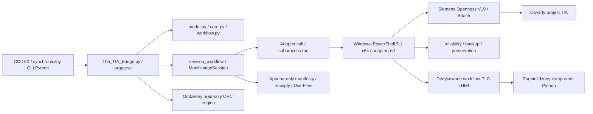

# 01 — Audyt obecnego T05_TIA_Bridge

## Zakres i wiarygodność

Audyt 2026-10-24 obejmuje `C:\RMA\t05_plc\tools\T05_TIA_Bridge.py`, `tools/t05_tia_bridge/`, dokumentację HMI, historię Git i wybrane lokalne logi. HEAD starego repo: `76dea4c1f5102de391b44b0b80aa037a03a0adcf`. Repo jest **dirty**; część komparatorów, recovery i pilot HMI 1:1 pochodzi z niezacommitowanych plików. Dokładne SHA-256, liczby linii i statusy plików znajdują się w [indeksie źródeł](evidence/source-index.json). HEAD sam nie odtwarza badanego kodu.

Nie zmieniano kodu starego Bridge, projektów TIA, uprawnień ani konfiguracji Siemens. Nowe odczyty: CLI help, doctor, processes, identify i inspect z PID wybranym ze świeżej listy. Testy offline wykonywały produkcyjne helpery na mockach i plikach tymczasowych. Nie wywoływano importu, Archive, Compile, Save, downloadu ani RUN/STOP. Wyniki nie stanowią testu odporności TIA_Bridge 2.

Oznaczenia dowodów: **K** — mechanizm przeczytany w bieżącym kodzie; **L** — lokalny zapis zdarzenia; **T** — test offline wykonany teraz; **H** — historia/dokumentacja, bez nowego live powtórzenia. Brak dowodu deadlocku nie jest dowodem jego niemożliwości. Miejsca poniżej są względem starego repo, numery linii orientacyjne dla hashy indeksu.

## Rzeczywista architektura

- `T05_TIA_Bridge.py:parser/run`: rozbudowany router komend i specyficznych przypadków T05. Stary termin **V2** w `workflow.py` oznacza generację protokołu obecnego narzędzia, nie projektowaną aplikację TIA_Bridge 2.
- `core.py:Adapter._call` (153–210): request JSON w `UserFiles`, nowy proces Windows PowerShell na wywołanie, `capture_output`, końcowy JSON na stdout, timeout domyślnie 120 s. Python nie przechowuje proxy Siemens. Request jest kasowany w finally; failure receipt zachowuje UNKNOWN i zabrania automatycznego retry.
- `adapter.ps1`: ładowanie dokładnych DLL i kontraktów V19, enumeracja procesów, Attach do jednego wybranego PID, weryfikacja projektu i urządzeń. Obiekty trzymane lokalnie w ramach jednego workera. ExclusiveAccess, import/generowanie, kompilacja, readback, centralny Save. Dispose w finally.
- `workflow.py:live_snapshot/execute_push`: świeże inspect→export→inspect, plan SHA, backup sesji, jawna grupa, wynik wykonania i niezależny re-eksport; ponowna kontrola źródeł po wykonaniu. `encoding.ps1:Stage-Source` kopiuje i sprawdza hash, konwertuje wyłącznie kopię. To istniejąca ochrona zmian CODEX, nie brak stagingu.
- `modification_session.py:project_lock/ModificationSession`: nieblokujący byte lock msvcrt dla całego katalogu sesji, persistent ownership, append-only rewizje z SHA chain i `fsync`. Lock OS zwalnia się po crash, nierozstrzygnięty pakiet nadal blokuje zapisy celowo.
- `reliability.ps1`: intent przed mutacją, fazy APPLIED/VERIFIED/SAVED, `Save()` + `IsModified=False`, kontrola PID/start/odbiorców, crash-prone API domyślnie zablokowane. Nie ma deklarowanej transakcji całego projektu.
- `recipes_sync_update.ps1`: specyficzny import trzech istniejących modułów i trzech zdarzeń; wielokrotne pełne snapshoty HMI pod ExclusiveAccess, eksport wszystkich modułów i wywołanie komparatora Python z PowerShell.
- `hmi.py`, `hmi_properties.ps1`, `navigation.ps1`: rozróżnienie klasycznego HMI i Unified, natywnych formatów i typowanego odczytu właściwości. Nie istnieje ogólny pełny screen XML round-trip Unified V19. `hmi_module_1to1.py` jest pilotem offline, nie pełnym eksporterem HMI.
- `opc_*`: odrębny asynchroniczny silnik read-only wykorzystujący istniejące `lib/opc`; każda komenda tworzy i zamyka sesję. Nie ma zapisów, subskrypcji testowych ani integracji symulatora odpowiadającej docelowemu zakresowi.

## Rejestr problemów i ograniczeń

Każdy wpis podaje lokalizację, mechanizm, objaw, skutek, priorytet, rozwiązanie i dowód. **Obecne** oznacza kod/ograniczenie istniejące w badanym snapshotcie; **historyczne, ograniczone** oznacza, że dodano zabezpieczenie, a nie usunięto przyczynę w Siemens. Ryzyka bez reprodukcji są wyraźnie oznaczone.

| ID / priorytet / stan | Lokalizacja i przyczyna | Objaw dla CODEX / wpływ | Rozwiązanie TIA_Bridge 2 i dowód |
|---|---|---|---|
| OB-01 / High / obecne | `core.py:run_powershell, Adapter._call`, 116–210: synchroniczny subprocess obejmuje całą operację | CLI zajęte do wyniku/timeoutu; agent trudniej kontynuuje niezależną pracę | host submit→operation_id, trwały status poza workerem; K, T `test_operation_reliability` potwierdza timeout policy, nie async |
| OB-02 / Critical / obecne | ten sam kod + `adapter.ps1` call Import/Compile/Archive: timeout procesu klienta nie odwołuje call po stronie TIA | brak odpowiedzi może oznaczać wykonany/częściowy import; retry grozi zdublowaniem skutków | journal granic mutacji, UNKNOWN/quarantine/reconciliation; L timeout inspect i L readback mismatch; brak twierdzenia o bezpiecznym kill |
| OB-03 / High / ryzyko kodowe | `recipes_sync_update.ps1:Update-Compare`, 69–80: `& pythonExecutable` bez własnego deadline; zagnieżdżone dzieci | po zakończeniu bezpośredniego PowerShell może pozostać dziecko; brak drzewa procesów | supervisor, ownership PID/start, bounded comparator, osobny proces core; K. Nie znaleziono dowodu aktualnie osieroconego procesu |
| OB-04 / High / obecne | `core.py` capture stdout/stderr do końca; stderr fazowy bez durable stream | CODEX nie widzi heartbeat i bieżącej fazy w standardowym wyniku; log rośnie w pamięci | event stream + bounded log + status z DB; K; L0 zawiera wiele snapshotów przed jednym błędem |
| OB-05 / High / obecne | `modification_session.py:project_lock` 46–66, `unfinished_sessions`: jeden globalny lock/ownership katalogu dla profili | drugie żądanie odrzucone, nie kolejkowane; nierozstrzygnięta sesja blokuje kolejne zapisy | scheduler per portal/project i trwała kolejka; unknown nadal blokuje ten projekt, nie niezależne offline zadania; K/T 25 testów |
| OB-06 / High / obecne | te same pliki: brak cancellation API i bezpiecznych granic cancel w lifecycle CLI | przerwanie CLI nie ma formalnego kontraktu; nie wiadomo czy call skończył | queued CAS cancel, cooperative running cancel, forced worker termination osobno; K; nie dodawać Thread.Abort |
| OB-07 / Medium / obecne | `Adapter._call` + `adapter.ps1` 34–100: nowy PowerShell, DLL i Attach na każde call | powtarzalny koszt i wiele okazji utraty połączenia; duże workflow z kilkoma attach | worker jednej sesji z epoch i idle recycle; X-01 mierzy attach/dispose; K; brak pomiaru zysku wydajności |
| OB-08 / High / obecne ograniczenie | `workflow.py:live_snapshot` 102–123: inventory przed/po nie stanowi atomowego snapshotu zawartości wobec zewnętrznego editora | ta sama lista obiektów może mieć różną zawartość; raport już ostrzega o nieatomowości | snapshot spójnej grupy pod kwalifikowaną blokadą lub change tokens + powtórny hash; niespójność UNKNOWN; K, nie dowiedziono utraty danych |
| OB-09 / High / obecne | `Read-Group`, `Read-Item` w adapterze i target ID budowany z nazw/hierarchii; import odrzuca non-root target (około 431) | rename/move zmienia ID; brak ogólnej synchronizacji grup i nazw specjalnych | bridge UUID + locator + jawne mapowanie rename i escaping; natywnego GUID nie zakładać; K |
| OB-10 / High / obecne | `model.py:source/tokens/xml_object/compare` i `three_way` 324+: parser podzbioru/regex, raw hash baseline | różnice techniczne mogą dawać conflict, nieznane właściwości wymagają review; brak pełnej semantyki LAD/SCL | versioned normalizers i coverage, osobne raw/model hashes; nie ogłaszać pełnego semantic equivalence; K/T `test_v2` |
| OB-11 / Critical / historyczne, ograniczone | `recipes_sync_update.ps1:Convert-SyncNativeImportCode` 4–10; import LF zmieniał podział global definitions / native function | kod tekstowo obecny, a funkcja nie występowała jako natywny węzeł; compile mógł przejść | golden native fixtures, jawny serializer CRLF i kontrola API/struktury; H commit `89e1e50`, T serializer; bez nowego live testu |
| OB-12 / High / historyczne, nadal możliwa niezgodność | `Update-ModuleIdentity/Update-EventIdentity`, 12–47; proxy Equals/recreation nie są trwałym identyfikatorem | `Object identity changed` po imporcie; zbędna blokada lub nieweryfikowalna relacja | re-resolve locator po kroku, owner/type/membership i struktura; Equals wyłącznie diagnostycznie; L1/L2, H `a65bf01`, bieżące K |
| OB-13 / Critical / historyczne, API ograniczone | `reliability.ps1:Invoke-BridgeSyntaxCheck/Set-BridgeTrigger`; Siemens SyntaxCheck/AutomaticTags dawały NonRecoverableException | awaria sesji TIA, potrzeba niezależnej diagnozy; root cause producenta nieznany | denylist capability, osobna kopia laboratoryjna, breaker; L3/L4 i T `test_operation_reliability`; nie ponawiać niebezpiecznego API |
| OB-14 / High / historyczne, storage nadal ogranicza | `adapter.ps1:backup`, `backups.py`, `backup_storage.ps1`: Archive używa temp C: mimo backupu X: | backup fail przed importem; destination free space nie wystarcza | storage budget na temp i destination, jeden backup sesji, integrity; L5. Zakaz automatycznego redirect TEMP/cleanup |
| OB-15 / High / obecne | `session_workflow.py:observe/saved_tree` 54–121, `reliability.ps1:Get-BridgeArchiveCheckpoint`: pełne hash tree + HMI/PLC/native read | drogi preflight/reconcile; zmiana diagnostyczna może wymagać obszernego review | bounded scope fingerprints i dependency boundary; pełny audit przy baseline/niepewności, nigdy ignorowanie unknown dla szybkości; K |
| OB-16 / High / obecne | `recipes_sync_update.ps1:Update-Snapshot` 82–130 i guard przed każdym zapisem 239+: pełne HMI/native exporty i Python→PS→Python | koszt rośnie z liczbą obiektów i kroków; długie ExclusiveAccess | core comparison w hoście, jeden immutable context, scope check per jednostka; konieczne protected invariants pozostają; K/L0 |
| OB-17 / Critical / obecne zdarzenie | `recipes_sync_update.py:verify`, worker readback; session `982a336fd22c4cf3a779cf81553fffec`, rev 13 | `Readback mismatch: RecipeFileApiTest`; FAILED/UNKNOWN, projekt dirty; dokładna przyczyna mismatch nierozstrzygnięta | zachowanie obu eksportów, native shape validation, kwarantanna i nowy recovery plan; L0 i manifest sesji; nie klasyfikować jako błąd normalizacji bez dowodu |
| OB-18 / High / częściowo rozwiązane | `modification_session.py:persist/load` 178–217: fsynced append-only, celowo blokuje ucięty plik; inne `write_new` bez fsync, result.json nadpisywany | trwałość niejednolita; crash w pliku może wymagać ręcznego review mimo poprawnego poprzedniego rekordu | SQLite intent/outbox + immutable artifacts i recovery niekompletnego ogona; K/T `test_manifest_truncation_not_accepted`; nie twierdzić, że brak journalingu |
| OB-19 / High / obecne | `workflow.py:execute_push` i `Start-BridgeOperation`: rozpoczęta jednostka nie jest bezwarunkowo ponawialna; brak globalnego request ledger | po utracie odpowiedzi klient nie ma prostego idempotent submit/status; bezpieczne odmowy wymagają osobnej procedury | trwałe idempotency key/request hash, result retrieval i reconciliation; K/T. Nie obiecywać exactly-once w TIA |
| OB-20 / Medium / obecne ograniczenie | `adapter.ps1` finally 595+, `core.py` finally: Dispose sprzątanie lokalne, brak supervisor inventory | hard kill omija finally; błąd Dispose może przesłonić główną diagnozę | cleanup result osobno, owned process tracking, quarantine gdy nieznany stan; K. Nie ma dowodu trwałego wycieku blokady OS |
| OB-21 / High / obecne ograniczenie | `core.py:PROFILE/PROJECT/OUTPUT/AUTHORITY/backup_root`, modułowy mutable global `select_profile` | narzędzie związane z T05, nie jest bezpiecznym wieloprojektowym serwisem; profile w jednym procesie mogłyby się mieszać po prostym dodaniu threads | immutable ProjectContext przekazywany jawnie; profile poza kodem + niezależna tożsamość; K. Obecny CLI nie ma równoległych wątków profili |
| OB-22 / High / obecne ograniczenie | `hmi.py:compare_native_module_exports`, 98–128; niepokryte API/STRUCTURE, HMI 1:1 tylko pilot | zgodny JS/YAML nie dowodzi layoutu ani public function nodes | coverage bitset, status UNKNOWN, reader natywny tylko wspieranym publicznym API; K/T `test_native_module_layers`; nie czytać wewnętrznych baz jako adapter produkcyjny |
| OB-23 / Medium / obecne ograniczenie | `opc_transport.py`, `opc_engine.py`, `opc_config.py`: read-only bounded snapshots, brak testowych writes/subscriptions, opcjonalne zależności | podstawowy Python dał dependency ImportError; venv status PASS; nie jest gotowym testerem sekwencji PLC | runner izolowany, lockfile, subscriptions i allowlist testowa w kolejnych etapach; świeży odczyt w [10](10_EVIDENCE_AND_QUALITY.md) |
| OB-24 / Medium / obecne ograniczenie | `T05_TIA_Bridge.py:parser/run`, per-task `*_readonly`, `recipes_*`, wiele stanów recovery | nazwa komendy nie zawsze opisuje możliwość mutacji; rozproszona wiedza potrzebna do użycia | jednolity registry operation/permissions/input/result/errors/timeouts i capability gating; K |

## Co już działa i powinno zostać zachowane koncepcyjnie

Nie należy usuwać zabezpieczeń pod pretekstem autonomii. Istnieją: SHA-256 immutable planów, ścisłe profile projektu i urządzeń, nieblokujące lock refusal, one-backup-per-session, sprawdzanie CRC archiwum, strict UTF-8 staging i kontrola concurrent source changes, chronione XML, odczyt po imporcie, centralny Save receipt i `IsModified=False`, append-only intent i UNKNOWN, brak automatycznego rollbacku oraz bounded OPC timeouts. Potwierdza je 94 wykonanych testów offline, opisanych w [10](10_EVIDENCE_AND_QUALITY.md).

Nie ma dowodu na nieograniczoną automatyczną pętlę retry. Przeciwnie: `core.py` po timeout zabrania retry/rollback, `Start-BridgeOperation` odrzuca ponowienie rozpoczętej jednostki, a refresh stale plan ma limit 1. Brak automatycznego recovery jest częściowo świadomym wyborem bezpieczeństwa. Nowy system powinien automatyzować rozpoznanie i diagnozę, nie automatycznie powtarzać nieznaną mutację.

Nie wykazano konkretnego cyklu blokad dowodzącego deadlocku. Zawieszenia/timeouty i NonRecoverableException są realne; możliwy deadlock w vendor call pozostaje hipotezą. Brak obecnie żywych workerów porzuconych przez analizę nie dowodzi, że nigdy nie pozostają. Nie znaleziono dowodu utraty plików CODEX przez obecny staging. Wymaganie nowego workspace zabezpiecza ten obszar również dla przyszłego export/pull.

## Historia i stan zastany

| Zdarzenie / dowód | Co wynika | Czego nie dowodzi |
|---|---|---|
| `062999e` | rozwój wielu workflow i sesji Bridge | ogólnej obsługi każdego projektu TIA |
| `a65bf01b05ca525e7e43f33bfe480831736cb1c5` | poprawy weryfikacji JS, recovery i niezależnych wymiarów porównania | rozwiązania każdego mismatch ani świeżego wdrożenia |
| `89e1e50c96d961387a965b21bdc7b11ff0ab3655` | serializer CRLF, regresja i zapis eksperymentu LF/CRLF | Runtime PASS; oba laboratoryjne warianty mogły kompilować się poprawnie |
| `76dea4c` | cel odwzorowania HMI 1:1 | ukończenia tego celu; pilot jest offline |
| `5cfcc6...`, dzisiejszy odczyt latest rev 14 ABORTED | stan nowszy od notatek o REVIEW_REQUIRED; wcześniejszy FAILED/UNKNOWN zachowany | wdrożenia lub naprawienia defektu przez samo zamknięcie |
| `982a336fd22c4cf3a779cf81553fffec`, rev 13 REVIEW_REQUIRED | nowszy FAILED/UNKNOWN po L0 | przyczyny mismatch ani pozwolenia na retry |
| świeży identify/inspect, PID 1916/start `2026-10-23T07:35:06.2014132Z` | poprawny attach V19, testowa ścieżka, 15 PLC obiektów, 7 ekranów, `IsModified=True` | izolacji fizycznej, zgodności dysku z pamięcią, bezpieczeństwa transferu |

Wcześniejsza obserwacja Responding=False jest historyczna. W tej analizie `Get-Process.Responding=True` oraz udany odczyt API wskazują chwilową dostępność; nie stanowią dowodu usunięcia przyczyny zawieszeń. API AssemblyVersion `19.0.0.0` i host build `1900.3.501.1` zapisujemy osobno.

## Lokalne dowody zdarzeń

Ścieżki poniżej znajdują się pod `C:\RMA\t05_plc\UserFiles\T05_TIA_Bridge\` (fizycznie X:). Nie kopiowano raw logów ani kodu projektu do nowego Git. Indeks zawiera SHA wybranych plików; w [10](10_EVIDENCE_AND_QUALITY.md) opisano ograniczenie dostępności na innej maszynie.

- L0: `adapter-failure-0fc2ce31399d4b3592f00e8f2d8237a5.json`, 2026-10-24 21:10:12Z, `Readback mismatch: RecipeFileApiTest`.
- L1: `adapter-failure-2836a22bf1e3478e91b61af3cd52e1a1.json`, `Object identity changed: T05RecipeCatalog`; L2: `adapter-failure-08fe27826b554723a618c224fc3c4cc0.json`, event Loaded.
- L3: `adapter-failure-4b331b0a6c184d938e0d8a70ebaafdbb.json`, 2026-10-22, `ScriptDynamization.SyntaxCheck`, Siemens NonRecoverableException.
- L4: `adapter-failure-5a13f2aad7da4be58151ede0993524f0.json`, Trigger.set_Type, ten sam typ wyjątku. Jest to granica awarii, nie identyfikacja błędu wewnętrznego Siemens.
- L5: `adapter-failure-5b26dd9512db46388f59f0774c88de79.json`, Archive: około 1.01 GB dostępne i 1.47 GB wymagane w temp C:. Historyczny problem pojemności, nie aktualny stan dysku.
- L6: `adapter-failure-017fc8e380124be3b35bed64a1eb61c7.json`, inspect TimeoutExpired/UNKNOWN, 2026-10-22. Nie dowodzi, że timeout był podczas zapisu.
- L7: `adapter-failure-6da35fdbac254547a957ac3a190536f4.json`, 2026-10-24, dwa procesy bez jawnego PID; bezpieczna odmowa, nie utrata komunikacji.

## Wniosek projektowy

Najważniejsza zmiana dotyczy granicy procesu i stanu operacji, a nie zamiany PowerShell na dowolny inny język. Zlecenia muszą przetrwać klienta i awarię workera; CODEX nie czeka na call Siemens. Trzeba zachować fail-closed przy niepewnym zapisie i ułatwić jego uzgodnienie, oddzielić czystą logikę porównania od proxy TIA i wprowadzić capability per typ. Każdy OB-01–OB-24 ma mechanizm w [03](03_ARCHITECTURE.md), [04](04_SYNCHRONIZATION.md), [06](06_TIA_INTEGRATION.md) lub [07](07_TEST_STRATEGY.md), a przypisanie etapów jest w [08](08_IMPLEMENTATION_PLAN.md).
