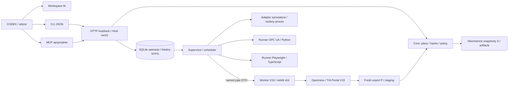
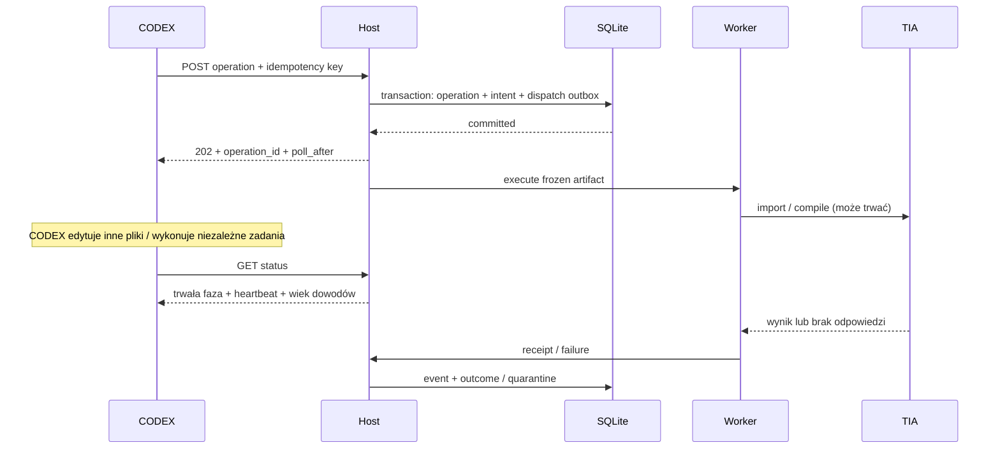

# 03 — Architektura komponentów i wykonania

Status: projekt, 2026-10-24. Wybór opiera się na [audycie](01_AUDIT_OLD_BRIDGE.md), działającym lokalnym .NET Framework/Openness V19 i wymaganiach nieblokującego interfejsu. Diagramy pokazują docelowe komponenty, nie istniejące procesy TIA_Bridge 2.

## Podział procesów



1. **TiaBridge.Host** (.NET 10, C#) działa jako proces użytkownika Windows w jego sesji, bez uprawnień administratora. Zawiera Minimal HTTP API, trwały scheduler, kontrolę uprawnień i supervisor. Windows Service/Session 0 nie jest domyślnym modelem: TIA, UMC i symulatory wymagają osobnej kwalifikacji sesji desktopowej.
2. **TiaBridge.Core** (.NET 10, bez vendor DLL) odpowiada za identity, model plików, hashe, plan, conflicts i verification. Czyste algorytmy można testować poza Windows. Kontrakty wire są JSON Schema, więc host i net48 nie muszą dzielić binarnej biblioteki Core.
3. **TiaBridge.Worker.V19** (.NET Framework 4.8, x64) ładuje dokładne zainstalowane DLL V19 z chronionej lokalizacji Siemens. Wersja, token i build są w handshake. Jeden właściciel wywołuje API; żadne proxy nie przechodzi przez IPC. Worker może być utrzymywany dla krótkiej sesji, a po błędzie/restart epoch jest wymieniany. Recycling jest dozwolony na idle, po Dispose i potwierdzeniu braku wywołania.
4. **TiaBridge.Adapters** docelowo dostarcza kontrakty i deklaracje możliwości adapterów. Czyste modele i registry B-01B są w Core/Capabilities, zgodnie z pakietem w backlogu; Adapters będzie ich konsumentem. [Implementacja offline](12_WORKSPACE_CAPABILITIES.md) nie jest adapterem Siemens. Każda wersja i rodzina HMI ma oddzielny profil, a nie reflection pozwalający wykonywać dowolną nazwę metody.
5. **TiaBridge.Cli** jest małym klientem API. Domyślnie submit/status/result; `--wait --max-wait` jest jawne i ograniczone. Wyjście CLI nie anuluje operacji.
6. **TiaBridge.Mcp** OPTIONAL przekłada tools na ten sam kontrakt. Baza i worker nie należą do procesu MCP; jego restart nie gubi zleceń.
7. **Runnery testowe i symulatorów** mają osobne procesy i limity. Używają odbiorców z zatwierdzonego profilu; nie łączą się z TIA alternatywnym kanałem ani nie omijają schedulerów.

Nowoczesny host wybieramy na .NET 10 LTS, dostępny lokalnie SDK `10.0.402`; wsparcie do listopada 2028 opisuje [polityka Microsoft](https://dotnet.microsoft.com/en-us/platform/support/policy/dotnet-core). Worker pozostaje net48, zgodnie z lokalnym kontraktem V19 i [przykładem Siemens V19](https://cache.industry.siemens.com/dl/files/999/109773999/att_1356247/v1/109773999_TIAV19_Add-In_Export_Import_DOC_v101_en.pdf). To rozdzielenie nie wymaga ładowania Openness w .NET 10 ani pythonnet. Alternatywa host Python + net48 worker jest wykonalna, lecz odrzucona na MVP: istniejący szkic jest .NET, a dodatkowy runtime i serializacja utrudniałyby packaging. Python pozostaje ograniczonym runnerem OPC i narzędzi QA.

## IPC i wątki

Named pipe ma ACL SID bieżącego użytkownika, losową nazwę, handshake nonce i `protocol_version`, limit ramki 1 MiB, length prefix, `operation_id`, `worker_epoch`, `sequence`. Duże źródła/eksporty są przekazywane jako artifact ID + SHA-256 w spool, nigdy jako nieograniczone komunikaty. Worker sprawdza containment/reparse points/hash przed otwarciem artefaktu. Ścieżek od klienta nie przekazuje się wprost do Siemens.

W workerze oddzielne zadania odczytu IPC i heartbeat są niezależne od serializowanego wątku wywołań. Callback Siemens publikuje ograniczony event i wraca; nie czeka na hosta ani lock trzymany przez wątek API. STA/MTA i ewentualny message pump są eksperymentem X-01, nie deklaracją wymogu Siemens. Nie stosujemy `Task.Run` do równoległego używania proxy. Brak eventu procentowego oznacza postęp fazowy, nie wymyślony procent.

Host rozdziela `host_heartbeat`, `worker_heartbeat`, `last_progress_at` i `tia_probe_at`. Żywy heartbeat nie dowodzi, że call TIA robi postęp. Probe do TIA też przechodzi przez kolejkę API; health hosta raportuje jego wiek, nie uruchamia nowego Attach w zawieszonym projekcie.

## Trwałe operacje i nieblokowanie CODEX



Przyjęcie nie obejmuje snapshotu 1 GiB ani Attach: host utrwala samo żądanie, a fazy `CAPTURING`, `WAITING_PROJECT`, `VALIDATING`, `BACKUP`, `APPLYING`, `COMPILING`, `SAVING`, `VERIFYING` wykonuje w tle. Dla Apply wejściem jest już niezmienny plan i snapshot z planowania. Kod HTTP nie oczekuje na lock projektu, proces ani Siemens. Status ma bounded DB read; klienci pollują według `poll_after_ms`, domyślnie 1 s, potem 2–5 s. Subskrypcja eventów SSE jest dodatkiem, polling działa po jej utracie.

Lifecycle: `ACCEPTED → QUEUED → RUNNING → SUCCEEDED|FAILED|CANCELLED|RECONCILIATION_REQUIRED`. `phase` i `cancel_requested` są oddzielne. `TIMED_OUT` jest kodem przyczyny, a nie dowodem zakończenia call. Terminalne RECONCILIATION_REQUIRED nie wraca do QUEUED; nowa operacja recovery odwołuje się do starej i pozostawia jej wynik.

## Baza, ownership i fencing

SQLite (jeden writer, WAL, `synchronous=FULL`, krótkie transakcje) znajduje się w `%LOCALAPPDATA%\TIA_Bridge2\state` na lokalnym NTFS. Nie na M:/exFAT, SMB ani w katalogu Git. [SQLite WAL](https://www.sqlite.org/wal.html) wymaga współlokalnych procesów i pamięci współdzielonej; wymaganie NTFS jest dodatkową polityką tego projektu dla ACL i walidacji durability. `FULL` i flush nie stanowią bezwarunkowej gwarancji wobec awarii sprzętu.

Minimalne tabele: `projects`, `sessions`, `operations`, `steps`, `events`, `idempotency_keys`, `leases`, `quarantines`, `snapshots`, `artifacts`, `plans`, `baseline_revisions`, `capabilities`, `authorizations`. Unique `(principal, project_key, idempotency_key)` oraz `(operation_id, event_sequence)`. Przyjęcie intentu i outbox w jednej transakcji. Event i nowy stan kroku razem. Przy wyniku z workera host sprawdza epoch i hash planu. Po timeout host nie ufa spóźnionemu `SUCCEEDED`; zachowuje receipt i uruchamia reconciliation.

Zapis artifactu: temp na tym samym NTFS → flush → SHA-256 → immutable rename → referencja w DB. Osierocony artifact po crash nie daje stanu sukcesu; GC usuwa tylko niepowiązane i nieprzypięte dane po grace period. Baseline jest immutable rewizją, a current pointer zmienia transakcja DB z CAS na expected revision. Kopia baseline w Git jest wymienialnym eksportem metadanych, nie drugim writerem stanu operacyjnego. Nie zakładamy transakcji obejmującej jednocześnie SQLite i TIA.

Scheduler serializuje wszystkie wywołania związane z danym portalem. Lock key zawiera host, SID sesji, PID/start i epoch; osobny `project_key` zapobiega zapisom tej samej tożsamości pod aliasem ścieżki. Na początek max 1 vendor call na host dla przewidywalności; zwiększenie równoległości między niezależnymi portalami wymaga X-01. Offline hashing/planning i pobieranie statusu nie czekają na ten lock. Kontrola singleton host + mutex/named pipe i Siemens ExclusiveAccess chronią przed drugim lokalnym Bridge; nie chronią przed dowolnym obcym klientem bez ponownego odczytu P pod ExclusiveAccess.

Lease: heartbeat co 2 s, ważność 15 s, rosnący fence. **Openness nie respektuje fence hosta**: utrata lease nie daje prawa drugiemu workerowi zapisać projektu. Przy niepewnym call trwała quarantine blokuje nowy dispatch mutacji nawet po wygaśnięciu lease, śmierci hosta i restarcie. Odblokowanie wymaga dowodu quiescence, świeżej tożsamości/readback i nowego planu.

## Watchdog, retry i restart

| Zdarzenie | Reakcja |
|---|---|
| queued cancel | atomowy CAS QUEUED→CANCELLED; dispatcher nie może już wysłać polecenia |
| running przed mutacją | anulowanie między krokami, sprawdzenie `ExclusiveAccess.IsCancellationRequested`, Dispose jeśli call wrócił |
| import/compile/Save w toku | zapis cancel intent; żadnego `Thread.Abort` ani twierdzenia o bezpiecznym przerwaniu; koniec na najbliższej bezpiecznej granicy |
| read timeout bez mutacji | operation FAILED/TIMEOUT; nowy odczyt dopiero po potwierdzeniu ustania starego call i zdrowego portalu |
| timeout po wysłaniu mutacji | RECONCILIATION_REQUIRED + quarantine; nie powtarzać polecenia |
| worker dead / pipe broken | zachować ostatnią fazę i hashe; wymienić worker po potwierdzeniu procesu; świeże proxy i readback; nie zamykać TIA |
| host restart | zrekonstruować kolejkę; RUNNING z możliwą mutacją od razu quarantine; istniejący worker identyfikowany po epoch/PID/start, nie adoptowany w ciemno |
| TIA restart | wszystkie proxy/snapshoty live tracą świeżość; nowy session epoch, ponowna enumeration, stary plan wymaga rewalidacji |

Job Object śledzi wyłącznie procesy Bridge i jego własnych runnerów. Polityka `KILL_ON_JOB_CLOSE` dla workera mutującego nie może być bezmyślnym domyślnym ustawieniem: śmierć rodzica nie jest zgodą na przerwanie importu. X-01 sprawdza model parent-loss, orphan reap i skutki Dispose. Wymuszone zakończenie własnego workera to odrębna, audytowana operacja administracyjna; nigdy nie jest rollbackiem i może pozostawić TIA wykonujące pracę. Portal użytkownika nie trafia do Job Object Bridge.

Retry wyłącznie dla zakwalifikowanych, nieefektowych odczytów po ustaniu poprzedniej próby: max 3 próby łącznie, backoff 1/2 s + jitter do 25%, łączny deadline. Błąd identity, schema, authorization, konflikt, NonRecoverableException albo możliwa mutacja: retry=0. Circuit breaker per portal/capability otwiera po 3 kolejnych awariach w 60 s, cooldown 60 s, jeden odczyt w half-open; kwarantanna mutacji ma pierwszeństwo nad breakerem.

## Docelowa struktura repozytorium

```text
contracts/v1/                    JSON Schema i przykłady wire (projekt)
src/TiaBridge.Core/               Identity, Workspace, Sync, Validation, Policy
src/TiaBridge.Adapters/           kontrakty adapterów i deklaracje dla Core/Capabilities
src/TiaBridge.Host/               Api, Operations, Storage, Scheduling, Supervision
src/TiaBridge.Worker.V19/         Bootstrap, Session, Plc, HmiUnified, HmiClassic
src/TiaBridge.Cli/                klient HTTP, JSON output, bounded wait
src/TiaBridge.Mcp/                opcjonalna fasada
src/TiaBridge.Simulation/         PLCSIM Advanced / Runtime Manager adapters
tests/unit/                      core, manifest, queue, policy
tests/contracts/                 schema i zgodność klientów
tests/integration/v19/           tylko zatwierdzone kopie syntetyczne
tests/resilience/                fake worker + fault injection
tests/e2e/opcua/                 Python, jawny profil i testowe NodeIds
tests/e2e/hmi/                   Playwright TypeScript, per-family fixtures
config/examples/                 bez sekretów i rzeczywistych odbiorców
examples/                        syntetyczne plany i manifesty
scripts/                         narzędzia z instrukcjami
docs/                            projekt, ADR i kontrolowane dowody
```

Istniejące trzy katalogi src zachowujemy; dodatkowe powstaną wraz z konkretnymi zadaniami, bez pustego szkieletu pozorującego implementację. Pakiety host/worker/test tools wersjonowane niezależnie z matrix compatibility. Vendor DLL nie są kopiowane do Git ani dystrybuowane bez sprawdzenia warunków; instalator odszukuje i waliduje lokalną instalację. Konfiguracja runtime/sekrety/DB/spool/logi są poza drzewem powyżej.
