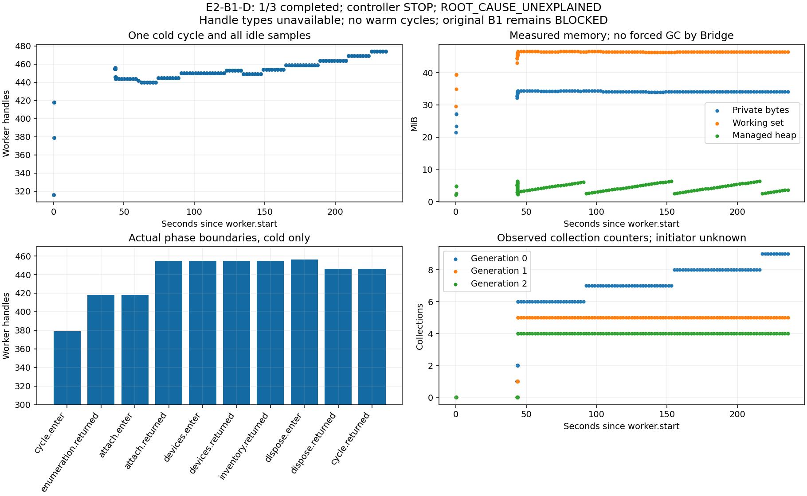

# B-03A/E2-B1-D — diagnostyka uchwytów V19

Przygotowanie 2026-10-27, wykonanie 2026-10-28. **INCOMPLETE — 1/3 cykli**,
**ROOT_CAUSE_UNEXPLAINED**. Jeden rzeczywisty cykl DiscoveryV1 zakończył się
SUCCEEDED/CONFIRMED, false/false i Dispose.Returned. Kontroler zatrzymał serię
przez błędne porównanie formatu ProjectKey. Nie było ponowienia ani cykli 2–3.
Grant odwołano; własny Host zakończył się kodem 0 i Worker został zwolniony.
TIA pozostała otwarta. Historyczny [B1](../tests/engineering/E2_B1_2026-10-27_06cbfec6.md)
pozostaje **BLOCKED**. Nowa kwalifikacja B1, B2, enrollment E1 i produkcja: NOT_RUN.

## Pochodzenie i bramki

Baza i origin gałęzi fix/e2-b1-worker-resource-investigation:
`28eb6ea7a018d466fe30fda782df4df85fed39b0`. Po świeżym fetch origin/main:
`16916d4f392b639a7936494a1c85f899fa4f3e0a`; raport B1 jest w historii gałęzi
diagnostycznej przez `30011c9774cda09c3d8d2ffbb3ae1be7e0506678`.
Nie wykonywano merge, rebase ani cherry-pick. Build obejmował jawnie zmienione
źródła przed commitem; SHA bazy nie jest twierdzeniem o czystym checkout.

Run: `09c962a01b2c46adb809184b401e19fb`.
Nowy Authorization ID: `4ad6efe6-fee5-417b-b914-a4c98fc83c7d`.
Operation ID cyklu 1: `e505f6aa-e1f9-4405-b397-707747e6d4e0`.
Worker epoch: `6354623f-f19f-4e96-92e8-e49954b31b12`, PID 8000; jeden proces,
bez restartu. Target: wyłącznie T05_RecipeSim_V19_Testowy, TIA PID 37492.
API FileVersion: `1900.0.6801.3`. Pełny świeży AP19/ProjectKey/PID/StartTime/
EXE/SID i wersje zapisano prywatnie w binding.json oraz fresh-preflight-20261028.json.
ProjectKey jest nowym UUID rejestracji Bridge, nie natywnym ID Siemens.

| Binding | SHA-256 |
|---|---|
| Host DLL | `002cf0ed1e4ca21acab8607878ab2b1ee3969b56d3f722585fdf5e2089cd5e4b` |
| Worker EXE | `a24cf5d63a5d7079c2bfec546d151bffc14e726aa0fb4830dc9f08260d58993a` |
| Plan E2-B1-D | `5861c9a573410d4076c8df717308e710e6da93461dc675f477b805d1ec7eb953` |
| Dokument autoryzacji | `e62a88f47dc261b3299c515106a7ac54e2face837f5ad68caccf79780e057759` |
| Pre-live źródła LF | `8e8c03ee0f2e441d89ec93f145f077c88add3135c06028367920e79668d3b7fd` |

Nowy lokalny state/deployment/bootstrap na fixed NTFS, ACL sprawdzono względem
rzeczywistego SID; zmieniono wyłącznie nowe katalogi testowe i config. Nie zmieniano
ACL projektów/ancestors, historycznego state ani kluczy E1. Stary grant B1 nie został
użyty ponownie. Okno nowego dokumentu: **04:17:12.7155195–04:37:12.7155195 UTC**.
bootstrap-inspect poprzedzało jawne bootstrap-authorize z exact hash i SID.

Aktualna ograniczona D-11 SHARED_WORKSTATION 1.0.0:
`051565cc4644458da5bc44e2b2e15eb4`, manifest 78 plików
`e8de3a4c523d7eb34081efdc9bee56b66a969fcc3b7c4b57b8d6182825ef5a85`.
Niezależna rekonstrukcja TRX/metryk/bytes/buildów i źródeł: PASS. Ograniczona
bramka D-11: PASS; E2-G-D: READY_FOR_OPERATOR_AUTHORIZATION, reasons=[].
READY nie aktywowało grantu. NF-11 i pełne NF-08 NOT_RUN; pełna kwalifikacja
pozostała BLOCKED, przy zaliczonym wymaganym pomiarze idle ≥300 s i ≥1000 Fake operacji.

## B0: osobna diagnostyka, wspólny ledger

Dodano lokalny dokument 1.1 / purpose HANDLE_DIAGNOSTICS / plan E2-B1-D /
maximum_cycles=3. Wszystkie cztery wartości są stałym zestawem. B1 1.0 bez pola
purpose nadal wymaga dokładnie 20 cykli i starego planu. Klient HTTP nie wybiera
budżetu ani celu; Core, IPC i normalny E1 nie otrzymały nowej capability.

Budżet pochodzi z zahashowanego, niezmiennego dokumentu odczytywanego w tej samej
transakcji istniejącego ledgeru v4 przed IPC. Rezerwacja jest trwała; crash, restart,
STOP i revoke jej nie odnawiają. Nie dodano migracji, drugiego ownera/schedulera,
alternatywnego Attach ani retry. Raport po trzech poprawnych cyklach może dać
DIAGNOSTIC_COMPLETE, nigdy B1 PASS; diagnostic bootstrap-review jest zabroniony.

Rzeczywisty ledger po cleanup: **REVOKED, used_cycles=1, 1 COMPLETED reservation**,
potwierdzony release. Nie wysłano czwartej operacji ani żadnej operacji na B2.
bootstrap-report: **INCOMPLETE, issues=[]**, manifest
`465d9779379f8f6fe4d5ac9dd81c16731d687dad2974b2247b0bfaf419f6329e`.
Brak issues nie oznacza ukończonych trzech cykli ani rozwiązanego ryzyka zasobów.

## STOP kontrolera i poprawka offline

Worker wire DTO serializuje project_key jako tekst UUID, natomiast Core Discovery
jako obiekt `{ "value": "UUID" }`. Kontroler porównał oba z tekstem i zgłosił
PROJECT_BINDING po poprawnym wyniku pierwszego cyklu. Był to potwierdzony błąd
kontrolera, nie niezgodność rzeczywistego targetu.

Niezależnie sprawdzono hash obu artefaktów, exact ścieżkę/nazwę/klucz/proces/API,
false/false, audit Dispose.Returned, pełne fazy i zdrowie Host. Dopiero po tym
review uznano native call za zakończony, odwołano grant i przekazano kontrolowany
stop przez istniejące stdin Host. Nie uznano samego timeoutu/STOP za dowód release.
Host PID 28716 exit=0; dokładny Worker PID/start zakończony; TIA PID/start pozostał.

Naprawiono wyłącznie porównanie dwóch dokładnych kontraktów w skrypcie kontrolera
i dodano syntetyczną regresję odrzucającą obcy klucz, ścieżkę, nazwę, dirty oraz
nieprawidłowy kształt DTO. Nie zmieniono kodu zarządzania zasobami Siemens w celu
usunięcia domniemanego wycieku. Po poprawce **nie wznowiono tego grantu**.

Fingerprint po STOP: `8586fbe8419665b3425d15b1a4882cdf8e6115f9ca766a289ec52b4e745763b0`.
Odwrócenie tylko tych dwóch zmian odtwarza dokładny pre-live fingerprint;
source-evolution.json i jawnie oznaczona rekonstrukcja uruchomionego kontrolera
zachowują provenance. Buildy Host/Worker nie zmieniły się po wykonaniu.
Następny grant wymaga nowej D-11/gate dla aktualnych źródeł, świeżego bindingu i ID.

## Rzeczywiste pomiary fazowe

Zachowano **126 rekordów** Workera, w tym 96 idle, oraz wszystkie próbki zewnętrzne
1 s, także baseline podczas oczekiwania na odblokowanie pulpitu. Zegar monotoniczny,
Operation ID, PID/start/epoch, handles/PB/WS/managed/threads/GC są dostępne.
Nie interpolowano braków. Cykl cold jest jedynym wykonanym; warm 2–3: NOT_RUN.

| Punkt | Handles | PB MiB | WS MiB | Managed MiB | GC 0/1/2 |
|---|---:|---:|---:|---:|---|
| worker.start | 316 | 21.445 | 29.633 | 2.063 | 0/0/0 |
| cycle.enter | 379 | 23.410 | 34.906 | 2.542 | 0/0/0 |
| enumeration.returned | 418 | 27.102 | 39.375 | 4.737 | 0/0/0 |
| attach.enter | 418 | 27.227 | 39.508 | 4.870 | 0/0/0 |
| attach.returned | 455 | 32.168 | 43.098 | 2.861 | 1/0/0 |
| project.checked | 455 | 32.699 | 44.414 | 4.928 | 1/0/0 |
| devices.enter | 455 | 32.699 | 44.414 | 5.060 | 1/0/0 |
| devices.returned | 455 | 32.887 | 44.566 | 5.216 | 1/0/0 |
| DeviceItems traversed, urządzenie 1 | 455 | 33.684 | 45.531 | 3.660 | 2/1/0 |
| classified, urządzenie 1 | 455 | 33.684 | 45.531 | 3.785 | 2/1/0 |
| DeviceItems traversed, urządzenie 2 | 455 | 33.750 | 45.617 | 5.948 | 2/1/0 |
| classified, urządzenie 2 | 455 | 33.875 | 45.742 | 6.073 | 2/1/0 |
| inventory.returned | 455 | 34.000 | 45.883 | 6.213 | 2/1/0 |
| dispose.enter | 456 | 34.188 | 46.125 | 6.414 | 2/1/0 |
| dispose.returned | 446 | 34.301 | 46.363 | 2.197 | 6/5/4 |
| cycle.returned | 446 | 34.301 | 46.363 | 2.337 | 6/5/4 |

Host before dispatch/after receipt: **335→444 (+109)**; to inne momenty niż
Worker cycle.enter/returned **379→446 (+67)**. Nie należy mieszać ich baseline.
Enumeration +39, Attach +37, granice Devices 0, inventory 0, identity-after +1,
Dispose −10. Wynik nie wyklucza alokacji i zwolnień pomiędzy próbkami.
14 markerów GetService/Software, z czego 2 present; wszystkie mają 455 uchwytów.
Są to pomiary po wywołaniu, bez osobnych granic każdego GetService i Software.
Discovery: 2 urządzenia (PLC/HMI Unified), 16 nodes; coverage i UNKNOWN zachowane.

Czasy raw: enumeration **103,5673 ms**, Attach **43 142,6992 ms**,
read **472,9447 ms**, Dispose **28,0288 ms**. Attach obejmuje oczekiwanie na dialog
i decyzję operatora; nie jest czystym kosztem API ani miarą wydajności warm.

| Rzeczywisty idle po cycle.returned | Handles | PB bytes | WS bytes | GC 0/1/2 |
|---|---:|---:|---:|---|
| 10,312 s | 444 | 36102144 | 48816128 | 6/5/4 |
| 30,464 s | 445 | 36020224 | 48799744 | 6/5/4 |
| 60,721 s | 450 | 35766272 | 48652288 | 7/5/4 |
| 121,168 s | 459 | 35823616 | 48701440 | 8/5/4 |
| 181,703 s | 474 | 35827712 | 48758784 | 9/5/4 |
| ostatnia: 191,761 s | 474 | 35827712 | 48758784 | 9/5/4 |

Idle to oczekiwanie na niezależny review STOP, bez kolejnego vendor call; nie był
planowanym final-idle po trzecim cyklu. Zakres idle **440–474**; ostatnia wartość
jest o 28 wyższa od cycle.returned. PB lekko spadły, WS niemal stały, managed heap
ma przebieg z powtarzalnymi spadkami przy wzroście GC0. W oknie Dispose GC wzrosły
2/1/0→6/5/4; instrumentacja i kontroler nie wymuszały GC. Sam licznik nie identyfikuje
inicjatora kolekcji w CLR lub bibliotekach. Brak dump/heap roots/object counts.

## Typy uchwytów i hipotezy

Event/File/Thread/Mutant/Section/Semaphore/Key/ALPC/Other: **NOT_AVAILABLE**, nie zero.
Nie znaleziono istniejącego handle/handle64/procexp w PATH i sprawdzonych typowych
katalogach narzędzi. Nie instalowano sterownika, nie podnoszono uprawnień, nie
obniżano zabezpieczeń, nie używano injection/debug attach/CloseHandle obcych zasobów.
Brak klasyfikacji i stosów alokacji uniemożliwia przypisanie właściciela uchwytów.

| Hipoteza | Dowód i ograniczenie |
|---|---|
| Wyłącznie GetService/Software powoduje wzrost | Cold granice inventory mają 455→455; idle rośnie bez nowych getterów. Wyłączność nie jest wsparta; wyciek warm nadal nie został sprawdzony. |
| Attach/inicjalizacja uczestniczy w przyroście | Bezpośrednie cold Attach +37 i enumeration +39. Nie rozdziela cache od wycieku ani kodu Siemens od CLR/IPC. |
| Dispose nie jest wywoływany | Obalona dla tego cyklu: audit Returned, quiescent receipt, handles −10 i cleanup. To nie dowód zwolnienia wszystkich wewnętrznych zasobów. |
| Wyłącznie granice kolejnych odczytów wyjaśniają wzrost | Nie: zaobserwowano idle +28 po jednym odczycie. Możliwe działanie tła po Attach, IPC/heartbeat, runtime lub instrumentacja wymagają kontroli. |
| Sam trace bez Siemens liniowo gromadzi handles | Dodatkowy test Framework bez Siemens: 120 Record, 614→603, ostatnie 60 próbek 603. Nie odtworzono wzrostu; inny proces/tempo/PowerShell i brak IPC ograniczają wniosek. |
| GC rozwiązuje wzrost | Nie wykazano. GC0 rośnie podczas idle, a handles nadal rosną. Brak forced GC i brak dowodu związku przyczynowego. |

Test trace użył reflection wyłącznie klasy instrumentacji z dokładnego deployed
Workera w osobnym Windows PowerShell/.NET Framework 4.0.30319.42000, bez Main,
Host, IPC, grantu i bibliotek Siemens (sprawdzone przed zakończeniem). 120 iteracji
co około 100 ms; trace 121 rekordów. Zachowano wynik, kod i informację o pierwszym
błędzie konwersji argumentu PSObject→String przed rozpoczęciem pomiaru. To kontrola
instrumentacji, nie wierna replika Workera ani dowód rozwiązania problemu.

## Porównanie i granice wniosku

Oryginalny B1: 20/20, Host cold +109, after 1→20 **456→620**, warm OLS
**+9,589474/cykl**, po 30,032 s idle **620→628**. B1-R oraz historyczny X-01
pozostają opisane w [dochodzeniu](B03A_E2_B1_RESOURCE_INVESTIGATION.md).
Nowy cold Host +109 jest zgodny co do delty, lecz różne buildy, instrumentacja,
baseline i brak warm nie pozwalają porównać nachyleń ani ogłosić poprawy.
Nowe fazy lokalizują cold zmiany oraz ujawniają wzrost po Dispose bez kolejnego
odczytu, ale **nie ustalają typu, właściciela, limitu cache ani przyczyny historycznego
wzrostu**. Ryzyko Workera pozostaje UNKNOWN. Nie zmieniono progów PASS.

## Walidacja i dowody

Build Release rozwiązania i Workera: PASS, 0 warnings/errors. Pełne Core **564/564**,
Host **399/399**, razem **963/963**; zawierają resilience, E1, B0 legacy/diagnostic,
syntetyczny VendorReader/Dispose/timeout/loss/20 sekwencji i Framework IPC probe.
Canonical Python **70/70** przed live; po poprawce kontrolera pełne **71/71**.
Pierwszy targeted test miał 80/82 (syntetyczny zegar wygaszał owner lease); poprawiono
setup testu timeout, nie kryteria lub kod ochronny. Pełna końcowa seria przeszła.
Format obu rozwiązań, audit_quality i git diff --check: PASS.
Nie ponawiano pełnego D-11 po poprawce Python: C# buildy nie zmieniły się, pełne
Python wykonano ponownie, a grant był już odwołany. NF-11 nie uruchomiono.

Ponownie zweryfikowano wszystkie **1069** oryginalnych plików B1, rozmiary,
SHA i kompletność; manifest
`a16d14f9e88deefd60b434e7e74e9a99ff3b8c566530135bcc8b955c844a0200`.
Oryginałów nie zmieniono. Nowe prywatne dowody są w per-user
`TIA_Bridge2/dev/e2-b1-d/09c962a01b2c46adb809184b401e19fb/evidence/`.
Manifest **243 plików** (manifest jest dodatkowym plikiem):
`c5be2e9fa2a766b4170085bb41794981f7556c4ceaba636365f3f8a95c92ea44`.
Niezależna weryfikacja PowerShell count/length/SHA-256: PASS.
Zawierają exact binding, authorization/window/hash, gate/D-11, phase CSV/JSONL,
pełne samples, raw/Discovery, audit, budżet/release, UI, provenance i manifest.
Nie pakowano API discovery tokenu, nie dodano prywatnych artefaktów projektu do Git.
AP19 hash i wszystkie metadane plików projektu before/after: bez zmian;
to odrębne, ograniczone potwierdzenie względem IsModified w pamięci.

Computer Use USED: odczyt właściwego projektu/properties/storage i czystego UI,
świeża kontrola po odblokowaniu pulpitu, sprawdzenie exact ścieżki Workera/PID w
standardowym dialogu Siemens, **Yes raz** (bez Yes to all), obserwacja po odczycie
i cleanup. Nie klikano Save/Compile/Download/Import/Export/Archive. Wcześniejsze
nieaktualne capture oznaczono nieważnymi i zachowano wraz z poprawnymi świeżymi
zrzutami; do decyzji użyto tylko tych ostatnich.

## Minimalny następny krok — nieuruchomiony

Najpierw offline: kontrola tego samego net48 IPC/heartbeat przez ≥120 s bez dispatch,
z trace włączonym/wyłączonym w osobnych procesach i tym samym tempie samplera.
Pozwoli oddzielić własne tło od skutków Attach. Sam krótki test trace nie zastępuje
tej kontroli. Jeśli możliwa jest bezpieczna klasyfikacja typów, zapewnić ją przed live.

Ewentualny nowy live: **osobno zatwierdzony nowy grant maks. 3 cykli**, nowa D-11,
fresh gate/build/plan/ProjectKey/AP19/PID/start/EXE/SID/API i chroniony dokument.
Jeden cold i dwa warm, te same punkty fazowe, 10 s idle po każdym i 180 s po trzecim;
bez retry/GC/restartu i bez zmiany read scope. Porównać delty w Attach/getterach/
Dispose z bezczynnością oraz kontrolą offline i typami. Te same STOP plus brak
telemetrii/niekontrolowany wzrost; nie rozszerzać grantu po wyniku niepewnym.
Nie zmniejszać ryzyka przez limity/recycling. Do rozstrzygnięcia utrzymać B1 BLOCKED.
