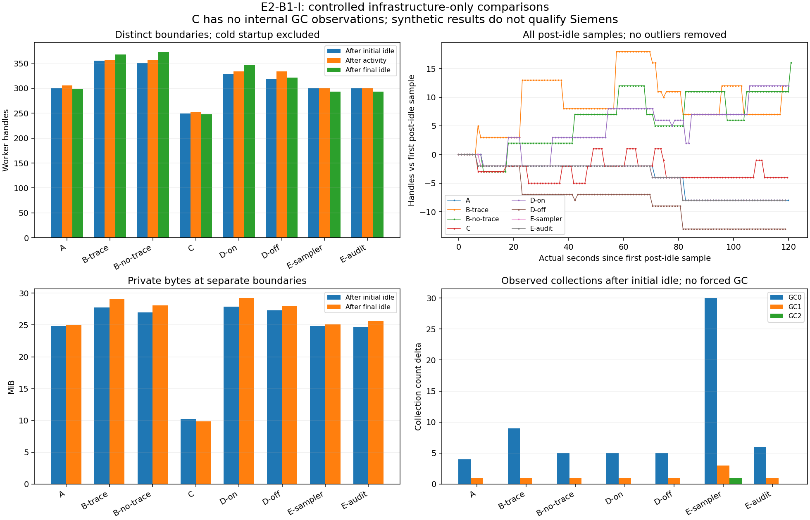
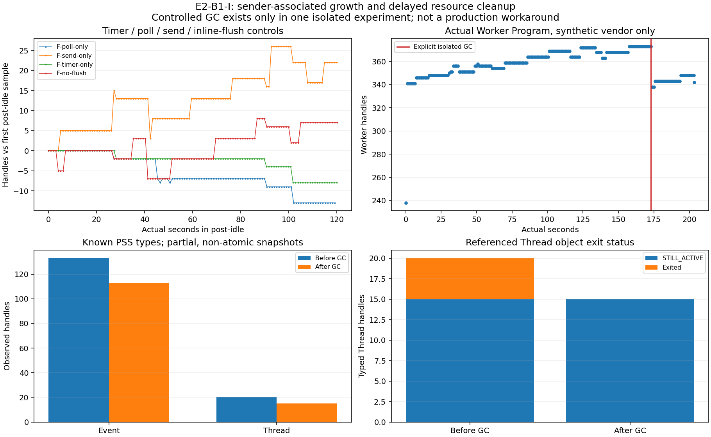

# B-03A/E2-B1-I — IPC, heartbeat i uchwyty Workera

Eksperyment offline, 2026-10-28. Baza i origin gałęzi
fix/e2-b1-worker-resource-investigation:
`2c5b14244d7f3d360afa465ad598315e7c2f9303`; origin/main:
`16916d4f392b639a7936494a1c85f899fa4f3e0a`. Czysty punkt startowy, bez
merge/rebase/cherry-pick. Historyczne [B1-R](B03A_E2_B1_RESOURCE_INVESTIGATION.md)
i [B1-D](B03A_E2_B1_D_HANDLE_DIAGNOSTICS.md) pozostają niezmienione.
Nie wykonano Siemens enumeration/Attach, nowego grantu, E1 enrollment ani B2.

**ROOT_CAUSE_PROBABLE:** dodatni trend jest odtwarzalny bez Siemens w ścieżce
okresowego wysyłania net48. Część zasobów pozostaje do GC/finalizacji, w tym
uchwyty do zakończonych wątków. Nie ustalono miejsca alokacji i właściciela
wszystkich Eventów ani udziału tej przyczyny w całym historycznym B1.
Produkcja bez zmian; B1 BLOCKED i Worker Handle Risk UNKNOWN zachowane.

## Architektura i metoda

Osobny [InfrastructureProbe](../tests/integration/TiaBridge.Worker.InfrastructureProbe/README.md)
net48/x64 kompiluje dokładny Program.cs Workera i WorkerResourceTrace, ze stubem
wyłącznie VendorResolver/VendorReader. Nie referencjonuje Siemens DLL; runtime
sprawdza brak załadowanych assemblies Siemens. Main dostaje puste argumenty.
Synthetic AP19 to tekstowa atrapa we własnym root, nie projekt TIA. Nie zmieniono
produkcyjnej semantyki Host/Workera/IPC/schedulera. Harness nie jest drugim
schedulerem ani alternatywnym Attach.

| Wariant | Składniki |
|---|---|
| A | net48/x64, wspólny sampler 1 s, bez IPC; baseline zawiera koszt obserwacji |
| B-trace | dokładny Program, STA, VendorGate, IPC 1.1, heartbeat 2 s, syntetyczne odczyty/audit, trace on |
| B-no-trace | ten sam Program, trace off; wspólny sampler pozostaje |
| C | rzeczywisty niezmieniony Host → Scheduler → FakeWorker przez normalne API |
| D-on / D-off | ta sama izolowana net48 pętla transportowa z/bez heartbeat, bez ownera/vendor |
| E-sampler | bez IPC, 100 odczytów Process/Threads/WindowsIdentity na interwał activity |
| E-audit | bez IPC, 100 append/flush/close FileStream na interwał activity, każdorazowy exclusive reopen |

Każdy wariant ma osobny proces/epoch/root i hash buildów. Seria sekwencyjna:
30 s initial-idle, 20 kroków activity w odstępie ≥1 s, 120 s post-idle i stop.
A/E nie udają operacji IPC: to sloty aktywności. C ma osobny cold seed, który
uruchamia lazy FakeWorker, a potem pustą kolejkę w initial-idle i 20 operacji.
Pozostałe warianty IPC mają 20 dispatchów. Cold jest oddzielony od idle.
Końca 30 s initial-idle nie uznano automatycznie za steady state: dalszy dodatni
trend w części wariantów świadczy, że stabilizacja nie została wykazana.

Pełne samples: handles/PB/WS/threads, UTC i Stopwatch ticks/frequency; net48
dodatkowo managed bytes i GC0/1/2. C nie zmienia FakeWorkera: managed/GC są
NOT_AVAILABLE. Obserwator ma oddzielne próbki. Seria podstawowa nie wymusza GC,
nie interpoluje i nie odrzuca outlierów. Osobny eksperyment GC opisano niżej.
Histogramy typów są odrębne i nieatomowe, na zmianach faz.
Shutdown snapshot jest po cleanup Main, nie przed zwolnieniem po końcowym idle.

## Typy uchwytów i zachowane niepowodzenia

Użyto udokumentowanego Windows PSS:
[Capture](https://learn.microsoft.com/en-us/windows/win32/api/processsnapshot/nf-processsnapshot-psscapturesnapshot),
[HANDLE_ENTRY](https://learn.microsoft.com/en-us/windows/win32/api/processsnapshot/ns-processsnapshot-pss_handle_entry),
[Walk](https://learn.microsoft.com/en-us/windows/win32/api/processsnapshot/nf-processsnapshot-psswalksnapshot)
i [Free](https://learn.microsoft.com/en-us/windows/win32/api/processsnapshot/nf-processsnapshot-pssfreesnapshot).
ABI x64 porównano z zainstalowanym SDK processsnapshot.h: 136 B, offsets
TypeNameLength=56/TypeName=64. W serii A–E flagi 0x14 obejmują handles/basic,
a w późniejszych kontrolach 0x34 dodają type-specific information,
bez nazw obiektów, pamięci, threads/context, VA clone lub trace alokacji.
Snapshot, walk marker i własny bufor zwalniane w finally. Typ nie dowodzi właściciela.
Nie znaleziono dostępnych Sysinternals Handle/Process Explorer ani dotnet-counters.
Nie instalowano narzędzi/sterowników, nie akceptowano licencji i nie zmieniano
uprawnień lub zabezpieczeń Windows.

Pierwszy smoke `80f730aa60d14f0c81e9ab1cf45f4c76`: self net48 częściowo działał,
ale zdalny PssCaptureSnapshot dla własnego FakeWorkera zakończył kontroler kodem
0xC0000005. Przyczyna natywnego błędu nieustalona. Po weryfikacji PID/start/config
Fake-only zakończono osierocony własny Host; FakeWorker zakończył się po utracie
połączenia. TIA nietknięta. Zachowano stderr, próbki i fault-cleanup.json.
Nie ponowiono remote PSS, nie obchodzono ograniczenia i nie podnoszono uprawnień.
Obecny kod odrzuca PID inny niż self; C klasyfikacja NOT_AVAILABLE.
Drugi smoke `4ef5292ec2ed4c4789f2bda9f775085d` przeszedł 8/8 po tej zmianie.
Smoke 1/2/1 s nie jest dowodem stabilności ani wybranym korzystniejszym pomiarem.

## Własność zasobów

| Zasób | Przegląd kodu |
|---|---|
| Named Pipes | jeden pipe per Worker; stream zamykany w cleanup, bez nowego połączenia per cykl |
| FramedConnection | skopiowany klucz czyszczony; jeden sendGate; HMAC/epoch/sequence/fence pozostają sprawdzane |
| SemaphoreSlim | brak AvailableWaitHandle; brak Dispose nie wystarcza do wykazania Windows handle leak |
| Heartbeat/timery | jeden loop Task.Delay 2 s z tokenem; cancellation i await w shutdown |
| Supervisor | własny Process i drain; handshake/exit event registration per proces, nie per cykl |
| Scheduler/watchdog | istniejące pump/lease/deadline; metadata status poza call; bez nowej ścieżki produkcyjnej |
| Process/ProcessThread | using/finally; wszystkie pobrane wrappery wątków Dispose |
| WindowsIdentity/token | Dispose identity, oryginalny token CloseHandle w finally; nie cudze uchwyty |
| FileStream | jawny close audit/trace/hash/artifacts; nowe dowody CreateNew, brak listy otwartych strumieni |
| Kolejka/STA | jedna BlockingCollection i owner; CompleteAdding/Join/Dispose po powrocie akcji |
| Kolekcje/Task | ograniczona historia DTO/receipts, bez proxy; ostatni execution Task, nie lista wszystkich zadań |
| JsonDocument/HMAC/SHA | jawne Dispose; obiekty zarządzane nie są automatycznie Windows handles |

Microsoft [Reference Source Task](https://github.com/microsoft/referencesource/blob/main/mscorlib/system/threading/Tasks/Task.cs)
opisuje w SpinThenBlockingWait MRES celowo bez Dispose, ponieważ ścieżka nie
korzysta z WaitHandle. Sam brak Dispose nie dowodzi alokacji finalizowalnych
zasobów. Reference Source nie jest dowodem dokładnych wnętrz zainstalowanych DLL.
Nie dodano spekulacyjnego Dispose/COM release ani produkcyjnego forced GC.
Odczyt IL zainstalowanych System/System.Core potwierdził Close w HasExited oraz
EndRead/EndWrite. FlushAsync jest dziedziczony z Stream. Próba pełniejszego
dekodowania IL FlushAsync pomocniczym skryptem nie zakończyła się poprawnie;
nie jest używana jako dowód instrukcji tej metody. Zachowano ten błąd.

## Wyniki A–E

Run `b076e39c676c4adebf6bd70d10d4ea4f`, source LF fingerprint
`d5622ccf5e7945fa55e743a6d983024cdfef699af09d470309cd0ef6b32d0a69`.
Dokładne buildy przed każdym scenariuszem sprawdzane ponownie:

| Artefakt | SHA-256 |
|---|---|
| InfrastructureProbe net48 | `1a601e81cfc0d0eb6cef00ac6811f8766f05dcb901e81d4de88442b084b24632` |
| Kontroler StorageProbe | `225f71b1d7d191957b63b050d74ed643014bb88dd1d204d80deb1b20426d24cc` |
| Host | `9fe67f43e2f704f6ffba84f9fbc877a840732077a4df0cc64fa288e6c13882d2` |
| FakeWorker | `7c63c4043a7cbe5bb3e9a73028aab206734e59757f98e5893912ed4c87960201` |
| IPC net48 | `2a2fa0b9f442ab24275fe8755a4e287eaf927a097b9ef7335a806e1b01f07e02` |

| Scenariusz | H po initial-idle | H po activity | H po post-idle | Δ względem initial | Δ w samym post-idle | H po cleanup Main* |
|---|---:|---:|---:|---:|---:|---:|
| A | 301 | 306 | 298 | −3 | −8 | 300 |
| B-trace | 355 | 356 | 368 | +13 | +12 | 362 |
| B-no-trace | 350 | 357 | 373 | +23 | +16 | 367 |
| C | 249 | 252 | 248 | −1 | −4 | brak |
| D-on | 329 | 334 | 346 | +17 | +12 | 354 |
| D-off | 319 | 334 | 321 | +2 | −13 | 324 |
| E-sampler | 301 | 301 | 293 | −8 | −8 | 295 |
| E-audit | 301 | 301 | 293 | −8 | −8 | 295 |

*Przed wyjściem procesu, nadal z własnym samplerem; nie po jego zniszczeniu przez OS.
Pierwsza cold próbka net48 ma 238 handles, przed inicjalizacją IPC i pierwszym PSS;
strumień wspólnego samplera jest już otwarty.
C nie ma pomiaru wewnątrz cold startu Fake: pierwsze 248 zmierzono dopiero po seed.
Nie podstawiono tej wartości jako rzeczywistego pomiaru początku procesu.
Wszystkie własne dzieci zakończyły się exit 0, Host C exit 0; nie było restartu
w obrębie scenariusza. Nowy proces per odrębny wariant służy izolacji, nie ukryciu
trendu. Nie zaproponowano recycling jako rozwiązania produkcyjnego.

Wewnętrzne próbki A/B-trace/B-no-trace/D-on/D-off/E-sampler/E-audit:
172/172/173/172/172/160/160; zewnętrzne C: 170 próbek Workera, wszystkie zachowane.
E-sampler i E-audit wykonały po **900**, nie 2000 dodatkowych operacji wrapper/stream:
koszt 100 powtórzeń wydłużał interwał; liczba pochodzi z rzeczywistych rekordów/audit.
C ma 21 terminalnych operacji, jeden Worker epoch, po jednej próbie; bootstrap
authorizations=0. Zamknięty ledger odczytano read-only i zweryfikowano hash przed/po.

W C pomocniczy URL health był błędny: zachowane **404**, nie health PASS. Poprawiono
adres na /v1/diagnostics/health i osobna regresja sprawdziła poprawny raport.
Ta sama regresja ujawniła pooling SQLite w nowym obserwatorze: Dispose połączenia
nie zwalniał fizycznego pliku do usunięcia. Pooling=false dla jednorazowego odczytu
oraz exclusive-open assertion naprawiają harness. Ten pool był w obserwatorze,
nie w Workerze; nie wyjaśnia wzrostu B/D. Zachowano pierwszy targeted wynik 8/9.

PB po idle wynoszą około 25 MiB w A/E, 28–29 MiB w B/D i 10 MiB w C, bez
porównywalnego monotonicznego wzrostu we wszystkich wariantach. Managed heap i GC
mają rzeczywiste przebiegi, nie interpolowane. Naturalne Gen2 wystąpiło w E-sampler;
w B/D standardowej serii licznik Gen2 pozostał 0. Spadek WS/heap nie jest dowodem
zamknięcia uchwytów. Pełne PB/WS/managed/GC i czasy są w surowych JSONL/CSV.

Poniżej rzeczywiste końcowe próbki initial-idle → post-idle. Pamięć w bajtach;
liczba działających wątków nie jest liczbą otwartych uchwytów typu Thread.

| Wariant | Private Bytes | Working Set | Managed heap | Wątki procesu | Gen2 |
|---|---:|---:|---:|---:|---:|
| A | 26013696→26271744 | 31567872→31866880 | 2073600→5240728 | 10→8 | 0→0 |
| B-trace | 29085696→30437376 | 38076416→39714816 | 5863528→6119888 | 16→13 | 0→0 |
| B-no-trace | 28258304→29466624 | 37134336→38633472 | 3673016→5423184 | 15→13 | 0→0 |
| C | 10731520→10334208 | 35835904→37445632 | NOT_AVAILABLE | 14→10 | NOT_AVAILABLE |
| D-on | 29257728→30646272 | 36667392→38219776 | 3697624→4264648 | 14→11 | 0→0 |
| D-off | 28643328→29298688 | 36687872→37445632 | 3709760→2852944 | 12→9 | 0→0 |
| E-sampler | 26054656→26300416 | 31604736→31973376 | 1958272→4623208 | 10→7 | 0→1 |
| E-audit | 25931776→26886144 | 31485952→32522240 | 1923392→3549552 | 10→7 | 0→0 |

## Kontrole przyczynowe i GC

Plan dodatkowych kontroli zapisano przed ich wykonaniem, po wzroście B/D.
Run `e913199814c74b719e5864339ba619a0`, Probe SHA
`8790f879462ba1f19668e0fd2cfa0f08ea2cfa97f671d9c8ba6f5ff653238d38`.
F ma 30 s initial-idle, **1** syntetyczny dispatch, 120 s post-idle; różni się
wyłącznie aktywną częścią pętli 2 s. GC-worker ma dokładny Program, 20 dispatchów
i zwykłe okno 30/20/120, dopiero później jawny test GC oraz 30 s dalszego idle.

| Kontrola | H initial | H na początku post-idle | H na końcu post-idle | Δ post-idle |
|---|---:|---:|---:|---:|
| F-poll-only: Refresh/HasExited, bez send | 319 | 324 | 311 | −13 |
| F-send-only: send, bez poll | 329 | 329 | 351 | +22 |
| F-timer-only: sam Delay | 319 | 324 | 316 | −8 |
| GC-worker, przed GC | 350 | 356 | 373 | +17 |
| F-no-flush: sender z inline PipeStream.Flush | 339 | 339 | 346 | +7 |

Ostatni wariant ma osobny run `e6f04a9e1d8e49cc878ff382fa88df44`, Probe SHA
`f37febe3b4fa82deed6068bfcb03a0240d2f2b4070bf3162403e3e3ec8520a4b`.
Testowy wrapper deleguje wszystkie odczyty/zapisy bez zmiany framingu/HMAC, ale
zastępuje odziedziczone FlushAsync przez PipeStream.Flush/CompletedTask.
Zachowano 75 heartbeatów i jeden poprawny receipt. Nadal wystąpiło +7, więc samo
planowanie flush nie jest wystarczającym wyjaśnieniem. Różnica +22/+7 przy jednym
przebiegu na wariant i innych buildach nie dowodzi przyczynowego udziału flush.
Nie przeniesiono tego wrappera ani zmiany flush do produkcji.

W metadanych ostatniego runnera pozostała myląca etykieta 20 slotów; immutable
spec.json i pojedynczy receipt dowodzą rzeczywistego **1**. Poprawiono tylko etykietę
narzędzia; zachowano oryginał i erratum. Odwrócenie tej zmiany odtwarza zapisany
hash uruchomionego skryptu; kod binarny i przebieg kontroli nie zostały zmienione.

Osobny GC: **373→338** handles, GC2 **0→2**. PSS przed/po:

| Obserwacja | Przed | Po |
|---|---:|---:|
| Event | 133 | 113 |
| Thread handles, razem | 20 | 15 |
| Referencje Thread do nadal aktywnych wątków | 15 | 15 |
| Referencje Thread do zakończonych wątków | 5 | 0 |
| File | 28 | 28 |
| Mutant/Mutex | 10 | 10 |
| Section | 17 | 17 |
| Semaphore | 10 | 10 |
| Key | 21 | 21 |
| ALPC Port | 6 | 6 |
| Private Bytes | 29474816 | 29474816 |
| Managed bytes | 2007888 | 2010232 |

Stan Thread pochodzi z PSS type-specific ExitStatus (259=STILL_ACTIVE), z PID/TID
w prywatnych danych. **Nie dowodzi**, kto utworzył Eventy, ani że te 20 Eventów
należy do tych 5 wątków. PSS jest PARTIAL: część wpisów nie ma type metadata;
snapshot i HandleCount nie są atomowe. Nie zbilansowano arbitralnie −35 jako sumy
znanych typów −25 ani nie przypisano różnicy do nieznanych obiektów.
Pozostałe odczytane typy obejmują Desktop, Directory, IRTimer, IoCompletion,
Process, Timer, TpWorkerFactory, WaitCompletionPacket i WindowStation. W obu
snapshotach 87 wpisów nie miało type metadata; nie zastąpiono ich zerami lub
domyślnym typem. Dla C wszystkie typy pozostają NOT_AVAILABLE.

Po GC sender nadal działał: w rzeczywistych 29,269 s obserwacji **338→348**,
bez następnego Gen2. To nie tylko jednorazowy cold start. Eksperyment potwierdza
zwalnianie części zasobów przez kolekcję/finalizację, ale nie ich stosy alokacji
i nie długoterminowy limit cache. Controlled GC jest wyłącznie w testowym Entry,
nigdy w produkcyjnym Program.cs; nie jest rekomendowanym obejściem.

## Wnioski i granice wykluczenia

Potwierdzono, że Siemens DLL/Attach/GetService nie są konieczne do analogicznego
wzrostu. Samodzielne audit/sampler, sam timer i sam poll procesu nie odtworzyły
dodatniego trendu w porównywalnym oknie. Nie wyklucza to ich kosztu ani interakcji
z transportem. Dodatni trend jest związany z wysyłaniem w net48; występuje także
bez trace, STA ownera i słowników produkcyjnego Workera w uproszczonej kontroli.
C net10 nie odtworzył go, ale używa IPC 1.0 i innego runtime/wykonawcy, więc nie
jest dowodem, że każda implementacja framingu lub schedulera jest bezwarunkowo wolna
od retencji. Brak jawnego Dispose w samym kodzie nie był podstawą spekulacyjnej naprawy.

**PROBABLE:** odroczony cleanup/finalizacja zasobów związanych z zakończonymi
wątkami/aktywnością asynchronicznego transportu net48. **UNEXPLAINED pozostają:**
konkretny stos alokacji, właściciel Eventów, zachowanie asymptotyczne i ilościowy
udział w historycznym B1. Nie potwierdzono błędu produkcyjnego do bezpiecznej naprawy.
Nie wprowadzono forced GC, recycling, zmiany limitów lub nowego kryterium PASS.

B1: 456→620, warm +9,589474/cykl; B1-D idle 446→474. Obecne próby wykazują
podobny mechanizm infrastruktury, lecz różne buildy, czas, brak Siemens i zakres
nie pozwalają uznać historycznego przyrostu za w pełni wyjaśniony lub usunięty.

## Walidacja i dalsze kroki

Regresje procesowe obejmują wielokrotne połączenia/epoch/fence, heartbeat on/off,
IPC 1.1, wyjątek syntetycznego gettera, timeout obserwatora bez abort/restartu,
wrappery samplera/audit, zamknięte strumienie, prawidłowy health i exclusive DB open,
PE references oraz runtime bez Siemens. Istniejące pełne suites obejmują restart,
worker loss, disconnect, late receipt, E1/B0 i odporność. Wyników fake nie przenosi
się na vendor cleanup. Release obu rozwiązań: PASS, 0 warnings/errors.
Core **564/564**, pełny Host po poprawce testu **409/409**, Python **71/71**;
bez pominiętych testów. Format verify obu rozwiązań, audit_quality i
git diff --check: PASS. Kod produkcyjny pozostaje niezmieniony.

Pierwsza pełna regresja `62e3d65da73c4b02a361aee4a218dcbc`: Core 564/564,
Host 408/409. Istniejący test
Expired_observation_budget_does_not_abort_native_owner_or_dispose_before_return
nie otrzymał sygnału wejścia w 5 s. Blokująca atrapa ownera była kolejnowana
przez Task.Run, a test blokował oczekiwanie na tym samym ThreadPool. Nie dowodzi
to samo w sobie konkretnego stanu puli w momencie awarii. Poprawiono wyłącznie
test: dedykowany LongRunning owner odpowiada produkcyjnej własności wątku,
sygnał jest asynchroniczny, finally zwalnia i oczekuje zakończenia ownera.
Budżet 5 s i asercje braku przedwczesnego Dispose pozostają bez zmian.
Zachowano pierwszy TRX/log/exit 1 i dokładne stare źródło testu; po poprawce
WorkerResourceTests + InfrastructureHandleTests: **23/23**. Pełny powtórzony Host
ma osobny run `ddd7c2f033444e6fb2fb6f6878d453d5`, jawnie SHARED_WORKSTATION;
nie jest nową kwalifikacją D-11, a NF-11 pozostaje NOT_RUN.
Nie uruchamiano pełnego validate_offline.py: zakres testowego harnessu zweryfikowano
bezpośrednio pełnymi suites Core/Host/Python, zawierającymi IPC, resilience, E1 i B0.

Ponownie sprawdzono oryginalne B1 **1069** plików i B1-D **243** pliki: kompletność,
bytes i SHA PASS, bez zmian oryginałów lub ich SQLite. Nowe raw JSONL/CSV, PSS,
receipts, procesy, buildy, source snapshots, błędy/smoke i walidacja są poza Git
pod per-user TIA_Bridge2/dev/e2-b1-i. Publiczne wykresy zawierają tylko metryki
syntetyczne, bez treści projektu, SID, tokenów lub ścieżek AP19.

Zamknięty pakiet nowej diagnostyki:
`%LOCALAPPDATA%/TIA_Bridge2/dev/e2-b1-i/b076e39c676c4adebf6bd70d10d4ea4f/evidence`.
Manifest obejmuje **1081 plików / 12180209 bajtów** (bez samego manifestu), SHA-256
`e0d190dc3bc7667f6369cd9a9f5e7f757240ec6dedb0b1383541bbfd86e19805`.
Kontrola Python oraz niezależne PowerShell Get-FileHash: **PASS** dla liczby,
długości i każdego SHA. Zawiera serię A–E, kontrole F/GC/flush, oba smoke,
historię błędów/testów i snapshoty źródeł/buildów. Wyłączono tokeny API
i SQLite DB/WAL/SHM (C ma zamknięty eksport ledgeru read-only). Końcowy publiczny
raport jest poza manifestem, aby uniknąć odwołania do własnego hasha;
receipts seal/niezależnej kontroli są obok pakietu. Własne procesy diagnostyczne
zakończone; nie ma pozostawionego InfrastructureProbe ani zmiany sesji TIA.
Końcowa kontrola staged wykryła CRLF w nowym wygenerowanym packages.lock.json;
znormalizowano go do LF bez zmiany JSON/zależności. Pakiet zachowuje oryginalny
snapshot; receipt before/after SHA i końcowe kontrole publikacji są obok pakietu.

Następny krok offline: stosy/korzenie alokacji Thread/Event w tym samym net48
senderze, z dostępnym narzędziem CLR/ETW/SOS i tymi samymi 120 s idle; bez
obniżania zabezpieczeń, akceptacji nowych licencji lub testu na TIA. Rozróżnić
tworzenie/retirement wątków i finalizację od trwałego rootowania obiektów.

Ewentualny live wymaga **osobnej decyzji**, nowej ograniczonej D-11/gate, buildów,
planu i exact bindingu/ID/okna. Maks. 3 read-only cykle przez istniejące B0,
bez GC i retry, z fazami/threads/GC oraz 180 s idle po trzecim; PSS self tylko po
osobnej kwalifikacji instrumentacji rzeczywistego buildu. False/false i potwierdzony
Dispose wymagane; stare STOP/budżety nie wracają. B1 pozostaje BLOCKED do właściwej
kwalifikacji; B2/real E1 enrollment/produkcja NOT_RUN. Computer Use: NOT_NEEDED.
