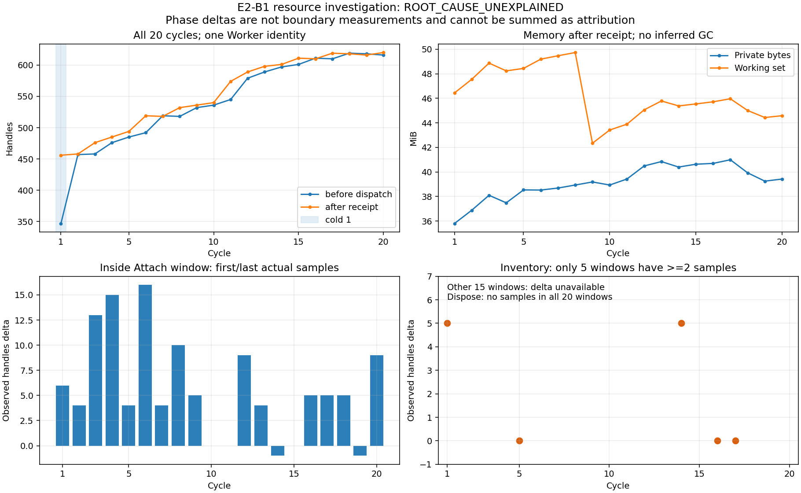

# B-03A/E2-B1-R — wzrost uchwytów Workera V19

Data: 2026-10-27. Baza: `30011c9774cda09c3d8d2ffbb3ae1be7e0506678` na
`docs/e2-b1-qualification-06cbfec6`; po fetch `origin/main=16916d4`.
Osobna gałąź diagnostyczna powstała bez merge/rebase/cherry-pick.

**ROOT_CAUSE_UNEXPLAINED.** Potwierdzono wzrost uchwytów, także w obserwacjach
wewnątrz Attach. Nie ustalono typów ani właściciela nowych uchwytów.
Nie naprawiono potwierdzonej przyczyny i nie zmieniono historycznego
[B1 BLOCKED](../tests/engineering/E2_B1_2026-10-27_06cbfec6.md).
Dodano ograniczoną, domyślnie wyłączoną instrumentację i regresje syntetyczne.
Nowe Attach/DiscoveryV1, grant, enrollment, B2 i NF-11: **NOT_RUN**.

## Dowody i integralność

Oryginalny B1 run `06cbfec6107d4627b015a0c5e5f433bd`, Authorization ID
`652cf95d-be6e-4e88-838b-826f7f314a2f`. SHA-256 manifestu:
`a16d14f9e88deefd60b434e7e74e9a99ff3b8c566530135bcc8b955c844a0200`.
Ponowny, niezależny odczyt PowerShell: wszystkie **1069 plików**, rozmiary,
SHA-256 i dokładna liczba plików PASS; manifest jest dodatkowym 1070. plikiem.
Nie otwierano źródłowej SQLite i nie zmieniano oryginalnych artefaktów.

Historyczny binding B1: API FileVersion `1900.0.6801.3`, Worker build
`1.0+bcc3a0fb661bd34b7cadc86afc53616544792b0e004491ee27f3c3c5fa7bcc8a`,
Host build `1.0+6a2a31be100b910e379b0ee4375e611eabc2b9ec9967ec06d8bc81ea6118784b`.
SHA-256 Siemens.Engineering.dll w zamkniętym raporcie:
`2d60b4bb34f810e67e78b8018e59a3b738b0a2393ef273164b4858f6c2196626`.
To historyczne tożsamości, nie kwalifikacja nowego buildu diagnostycznego.

Odczytano report, raw/Discovery artefakty, bootstrap cycles/initial telemetry,
telemetry.jsonl, audit, Operation ID, events, health, release, stdout/stderr,
provenance lokalnego samplera i before/after. Jeden Worker PID/start/epoch przez
całą serię, brak restartu i recycling. Wszystkie 20 cykli miały potwierdzony
Dispose.Returned i quiescent receipt; kontrolowane zakończenie własnego procesu
potwierdzono osobno. Nie utożsamiamy powrotu Dispose ze zwolnieniem wszystkich
wewnętrznych zasobów producenta.
Wszystkie raw wskazują jednego managed ownera `9`, STA i
PortalAliveAfterDispose=true; callback Disposed był obserwowany w każdym cyklu.
Numery wątków zarządzanych nie identyfikują typu ani właściciela Windows handle.

Nowe wyniki analizy są oddzielnie pod per-user
`TIA_Bridge2/dev/e2-b1-r/a0509f55e2c94f94a5bbfcd8613024ec/`.
Zawierają source-integrity.json, phase-analysis.json, pełną tabelę CSV,
metadane API, wykres i końcowe dowody walidacji. Prywatnych nazw urządzeń,
ścieżek AP19, SID, surowych logów/projektów i vendor DLL nie dodano do repo.

## Trend wszystkich 20 cykli

Próbki Host **before dispatch / after receipt**, nie bezpośrednie granice getterów.
Pierwsza zewnętrzna obserwacja Workera po starcie: **312** uchwytów; przed pierwszym
dispatch Host zmierzył **347**. To dwa różne momenty inicjalizacji, nie rozbieżność
do uśrednienia. Cold cykl 1: **347→456 (+109)**. After 1→20: **456→620 (+164)**.
Warm 2→20 after: **458→620 (+162)**;
łącznie pierwszy before→ostatni after: **+273**. Suma delt wewnątrz cykli: +265,
między after poprzedniego a before kolejnego: +8. Spadków nie usuwano.

W tabeli PB/WS są MiB po receipt. Δ między = before bieżącego minus after
poprzedniego. Δ Attach/inventory = ostatnia minus pierwsza **rzeczywista próbka
wewnątrz** okna audytu, wyłącznie przy N≥2. „—” oznacza brak dowodu delty.
Tych delt nie wolno sumować jako rozkładu przyczyn przyrostu całego cyklu.

| Cykl | H przed | H po | Δ cykl | Δ między | PB MiB | WS MiB | Δ w Attach | Δ w inventory |
|---|---:|---:|---:|---:|---:|---:|---:|---:|
| 1 | 347 | 456 | 109 | — | 35.805 | 46.441 | 6 | 5 |
| 2 | 457 | 458 | 1 | 1 | 36.883 | 47.551 | 4 | — |
| 3 | 458 | 476 | 18 | 0 | 38.098 | 48.867 | 13 | — |
| 4 | 476 | 485 | 9 | 0 | 37.484 | 48.234 | 15 | — |
| 5 | 485 | 494 | 9 | 0 | 38.535 | 48.434 | 4 | 0 |
| 6 | 492 | 519 | 27 | -2 | 38.523 | 49.188 | 16 | — |
| 7 | 519 | 518 | -1 | 0 | 38.688 | 49.465 | 4 | — |
| 8 | 518 | 532 | 14 | 0 | 38.934 | 49.727 | 10 | — |
| 9 | 532 | 536 | 4 | 0 | 39.184 | 42.340 | 5 | — |
| 10 | 536 | 540 | 4 | 0 | 38.934 | 43.414 | 0 | — |
| 11 | 545 | 574 | 29 | 5 | 39.422 | 43.891 | 0 | — |
| 12 | 579 | 589 | 10 | 5 | 40.488 | 45.059 | 9 | — |
| 13 | 589 | 598 | 9 | 0 | 40.844 | 45.781 | 4 | — |
| 14 | 597 | 601 | 4 | -1 | 40.398 | 45.379 | -1 | 5 |
| 15 | 601 | 611 | 10 | 0 | 40.629 | 45.539 | 0 | — |
| 16 | 611 | 610 | -1 | 0 | 40.695 | 45.715 | 5 | 0 |
| 17 | 610 | 619 | 9 | 0 | 40.992 | 45.961 | 5 | 0 |
| 18 | 619 | 618 | -1 | 0 | 39.930 | 45.008 | 5 | — |
| 19 | 618 | 616 | -2 | 0 | 39.250 | 44.434 | -1 | — |
| 20 | 616 | 620 | 4 | 0 | 39.422 | 44.582 | 9 | — |

OLS after względem numeru cyklu warm 2–20, N=19: **+9,589474 handles/cykl**.
Warm min/median/max: **458/574/620**. Mediany okien 2–7, 8–13, 14–20:
**489,5 / 557 / 616**, N=6/6/7. Nie wprowadzono dopuszczalnego progu przyrostu.

Private Bytes after cold 37 543 936 B, po 20: 41 336 832 B (39,422 MiB).
Warm after 2→20: +2 662 400 B; OLS +168 920,48 B/cykl, ze spadkami po późniejszych
cyklach. Working Set after cold 48 697 344 B, po 20: 46 747 648 B (44,582 MiB),
warm OLS −252 378,27 B/cykl. Spadek WS nie dowodzi naturalnego GC ani braku
niezwolnionych uchwytów; B1 nie mierzył liczników GC, heap roots ani managed bytes.

Idle po cyklu 20: **30,032 s zegara monotonicznego**, 32 rekordy z punktami
granicznymi, handles **620→628**, min/max 618/628. Cały dodatkowy idle do shutdown
zachowano (59 rekordów; min/median/max 618/628/633). UTC w audit/sampler służy do
korelacji faz; jego różnicy nie podmieniamy za monotoniczny czas idle.

## Co da się przypisać fazom

684 rekordy samplera obejmują 642 próbki interwałowe; maksymalny odstęp 1047 ms.
W każdym Attach są rzeczywiste próbki. W **15/20** okien first→last rośnie;
w trzech delta=0, w dwóch −1. Okno obejmuje także oczekiwanie na zgodę Siemens,
pracę heartbeat/IPC/CLR i inicjalizację; sam związek czasowy nie wskazuje właściciela.
Cold: po wejściu w Attach pierwsza próbka ma już 440 handles, więc nie obserwowano
większości początkowego skoku 347→440.

`Project.Devices.ReadBounded`→`Project.IdentityAndIsModified.ReadAfter` łączy
Devices, rekurencję DeviceItems, GetService/Software i klasyfikację. Tylko pięć
okien ma ≥2 próbki; pozostałe nie dają delty. **W żadnym Dispose nie ma próbki
wewnątrz okna**, nawet przy outlierze 953,8672 ms. Nie da się odtworzyć delty
Dispose ani odrębnej delty GetService/klasyfikacji z istniejącej serii.

Wszystkie grafy są identyczne: PLC i HMI Unified, null/unknown zachowane.
Nie było serii kontrolnej „bez HMI”, „bez GetService” ani „sam Attach”. Dlatego
nie przypisujemy wzrostu rodzinie HMI lub konkretnemu getterowi. Wszystkie CLI
zakończyły się exit 0, audit nie zawiera ReadFailed. Host/store/worker były HEALTHY;
niezakwalifikowane worker_progress/tia_probe UNKNOWN pozostają widoczne.
Brak wyjątku nie wyklucza retencji wewnętrznej.

## Przegląd API i zarządzania zasobami

Lokalne Siemens.Engineering.xml, SHA-256
`873d699ff53c080f26f9fcfc839d4da95bf632ee15b1600ce3075d40185ee8ac`, opisuje
Attach jako dodatkową instancję połączoną z procesem. **TiaPortalProcess.Dispose
zamyka proces TIA**. Reader słusznie go nie wywołuje; zwalnia własny TiaPortal
w finally. Nie dodano Dispose do obiektów TiaPortalProcess zwracanych przez enumerację.

PEReader/MetadataReader .NET 10 odczytał definicje publicznych typów z lokalnych
DLL **bez Assembly.Load, konstruktorów lub wywołań vendor**. TiaPortal i
TiaPortalProcess są zarządzanymi klasami z IDisposable, ale z różną semantyką.
Project/Device/DeviceItem/SoftwareContainer i ich sprawdzone bazy nie implementują
IDisposable; typy nie mają flagi Import. Dodatkowy odczyt objął HW.Software,
SW.PlcSoftware i HmiUnified.HmiSoftware z ich bazami: również brak IDisposable
i flagi Import. Dotyczy to klas PLC/Unified obecnych w B1, nie kwalifikacji
wszystkich wariantów klasycznego HMI. SHA-256 i FileVersion czterech aktualnych
vendor DLL porównano z zamkniętym B1 report: zgodne, bez ładowania kodu.
Runtime type names z B1 odpowiadają
publicznym klasom API, nie __ComObject. Nie dowodzi to braku wewnętrznego COM,
WCF, native IPC lub zasobów producenta. Nie ma dowodu, że te referencje są RCW;
nie dodano Marshal.ReleaseComObject/FinalReleaseComObject. Microsoft opisuje
[ReleaseComObject](https://learn.microsoft.com/en-us/dotnet/api/system.runtime.interopservices.marshal.releasecomobject)
jako operację na RCW i wskazuje ryzyko uszkodzenia pamięci przy niewłaściwym użyciu.

| Obiekt/ścieżka | Własność i cleanup | Ustalenie / ograniczenie |
|---|---|---|
| TiaPortal z Attach | lokalny właściciel, finally Dispose, audit Returned | wszystkie 20 powrotów; brak dowodu pełnego vendor cleanup |
| Project, Device, DeviceItem, SoftwareContainer/Software | lokalne zmienne odczytu; do DTO trafiają wartości/stringi | brak wskazania do arbitralnego Dispose/COM release; vendor cache nieobserwowalny |
| Enumeratory Devices/DeviceItems | foreach emituje finally/Dispose dla IEnumerator<T> | nowy test dokładnego kodu sprawdza aktywne enumeratory także przy wyjątku |
| Callback Disposed | kolejka numerów wątku, bez IO/API; najwyżej 64 wpisy | nie eksportuje proxy; hipotetyczny vendor root subskrypcji niezweryfikowany |
| Process / ProcessThread | using/Dispose dla własnych wrapperów | nowa telemetria także zamyka wszystkie odczytane wrappery w finally |
| Token WindowsIdentity / natywny token | using WindowsIdentity i finally CloseHandle | brak dowodu kumulacji tej ścieżki; nie zmieniono binding checks |
| FileStream audit/hash/artifact | using i zamknięcie po flush | brak stałej listy otwartych plików; nowe testy otwierają log wyłącznie po każdej próbce |
| VendorGate Mutex | using, ReleaseMutex i Dispose | wyłączność zachowana również przy wyjątku |
| NamedPipe/FramedConnection | jeden pipe/sekret/epoch, stream zamykany przy cleanup | brak nowego połączenia na cykl; framing nie zmieniony |
| SemaphoreSlim sendGate | jeden na FramedConnection; brak użycia AvailableWaitHandle | brak Dispose to temat higieny lifetime, nie dowód +N uchwytów/cykl; nie wprowadzono spekulacyjnej poprawki |
| commands/completed/cancelled | bounded do 1000, replay receipts zachowane | DTO/JSON/identyfikatory, bez Siemens proxy; retencja zarządzana jest zamierzona i nie dowodzi źródła Windows handles |
| execution / queue owner | ostatni task, jedna kolejka, owner.Join przy shutdown | timeout/parent loss nie przerywają native call; brak nowego retry/kill |
| Host i zewnętrzny sampler | odczyty liczników innego procesu | uchwyty obserwatora nie są automatycznie uchwytami Workera; brak typów utrudnia pełną diagnozę |

Nie znaleziono jednoznacznego błędu wyjaśniającego historyczny przyrost.
Nie ogłaszamy naprawy na podstawie samego przeglądu using/finally.

Uzupełniająco sprawdzono oficjalny
[Readme V19 Update 5, 10/2025](https://cache.industry.siemens.com/dl/files/643/109925643/att_1344820/v1/ReadMe_TIA_V19_UPD5_enUS.pdf)
pod kątem Openness, memory i handle. Nie znaleziono opisu wiążącego ten konkretny
trend Attach/Dispose z poprawką producenta. Wzmianka o memory leak dotyczy
alarm control w Runtime, więc nie stanowi dowodu przyczyny Workera. Nie wynika
stąd brak innych znanych problemów ani rekomendacja aktualizacji. Pełny manual
V19 pod adresem support/109826886 zwrócił HTTP 403; semantykę typów oparto na
dostępnych lokalnych XML/metadanych, bez uzupełniania treści manuala domysłami.

## Porównanie X-01

Ponownie odczytano lokalne qualification.json i porównano SHA z historycznym
[raportem X-01](X01_TIA_V19_QUALIFICATION.md) / jego JSON:

| Tryb / run | SHA-256 qualification.json | Obserwacje | Handles first→last |
|---|---|---:|---:|
| STA `98a2ac3a1f4945759947b509acf38630` | `d3c4f93cf0793353041e0452a23d5559877ce47e846a0081cf97da4a55fd4ac4` | 40 | 462→702 |
| MTA `c2327b77fd6d49128aa3bd3c17e343bd` | `cfe00fa4622f6a34f4614fee426408ffd91c8fb00b6cb9875e7bd841215c2170` | 40 | 456→602 |

Zgodność hashy PASS dotyczy tych raportów, nie nowej pełnej weryfikacji wszystkich
historycznych artefaktów. Dwa projekty były przeplatane na jednym Workerze;
inne buildy, gettery, rozmiary, czasy i obsługa dialogów uniemożliwiają porównanie
slope jako regresji ilościowej. Wzrost poprzedzał obecny profil DiscoveryV1 i wystąpił
w obu apartmentach. Nie wykazano przyczyny specyficznej dla STA, nowego modelu
grafu lub konkretnej rodziny PLC/HMI.

## Hipotezy i dowody rozstrzygające

| Hipoteza | Wspiera | Przeczy / brak danych | Potrzebny dowód |
|---|---|---|---|
| Jednorazowa inicjalizacja/cache | duży cold skok, mały wzrost PB | warm handles i idle nie wracają do wczesnego poziomu | typy uchwytów i fazowe delty kolejnych Attach |
| Retencja per Attach / vendor channel | dodatnie delty już w 15 oknach Attach; podobne X-01 | heartbeat i CLR działają równocześnie, brak histogramów | before/after Attach + typy Event/File/Section/Mutant/Thread |
| GetService / traversal / HMI | dalsze przyrosty w części dłuższych odczytów | brak osobnych próbek; wzrost także przed traversal | próbki po Software i po drzewie, bez nowych getterów |
| Logowanie / IPC / monitoring | wykonywane w każdym cyklu | strumienie/tokeny w using; jeden pipe; brak typów | osobny net48 probe 20 ramek + trace; nie zastępuje Siemens |
| Finalizacja/GC opóźnia cleanup | PB/WS mają spadki | brak liczników GC i obiektów w B1 | naturalne GC0/1/2 i managed bytes wraz z handles; bez forced GC |
| Niedokończony Dispose | zasoby pozostają po wywołaniu | wszystkie Returned, quiescent receipt i własny proces zakończony | typy/korzenie zasobów; sam powrót nie rozstrzyga |

Wszystkie pozostają hipotezami; nie przypisujemy PROBABLE konkretnej bibliotece.

## Wprowadzone zmiany i granice instrumentacji

[WorkerResourceTrace](../src/TiaBridge.Worker.V19/WorkerResourceTrace.cs) jest
domyślnie wyłączony. Jedyna aktywacja: lokalne środowisko startowe własnego
Host/Workera `TIA_BRIDGE_V19_RESOURCE_TRACE=1`, **dopiero w osobno zatwierdzonym
eksperymencie**. Nie ustawiono tej zmiennej dla prawdziwego Workera w tym zadaniu.
Przełącznik nie nadaje uprawnień, nie zmienia E1/B0 i nie pochodzi z HTTP/request.
Zły niepusty przełącznik odmawia startu; pusty nie tworzy plików.

Po zweryfikowanym peer/Ready powstaje create-new
`<ArtifactRoot>/v19-resources-<epoch>.jsonl`, tylko pod per-user TIA_Bridge2 na
fixed NTFS, bez reparse. Limity: 4096 rekordów i 1 MiB; brak overwrite lub rotacji.
Przekroczenie limitu/błąd odczytu/zapisu oznacza niekompletną diagnostykę i STOP,
nie utratę starszych dowodów ani większy limit. Plik trzeba osobno zahashować
w końcowym pakiecie; obecny bootstrap-report nie włącza go automatycznie.

Każdy rekord: schema `v19-resource-trace/1`, sequence, Operation ID, Worker epoch,
PID/start ticks, UTC i monotoniczne elapsed ticks/frequency, handles, PB, WS,
threads, managed bytes oraz GC0/1/2. Brak nazw/treści projektu i brak heap dump.
To liczniki, nie liczba żywych Siemens obiektów ani lista ich korzeni.

Punkty: cycle.enter, enumeration.returned, attach.enter/returned, project.checked,
devices.returned, software.returned.null/present, device_items.traversed,
device.classified, inventory.returned, dispose.enter/returned, cycle.returned.
Punkt software obejmuje razem GetService i Software; null nie rozstrzyga,
czy brakowało kontenera, czy jego Software. Nie dodano getterów do rozróżnienia.
Heartbeat może dodać worker.idle po zaobserwowaniu busy=0; to pomocnicza obserwacja,
nie atomowy dowód quiescence ani zamiennik receipt/audit. Sampler zewnętrzny nadal
wymagany; okno idle w eksperymencie musi być wolne od nowych submitów.

Snapshot zamyka własne wrappery Process/ProcessThread, potem otwiera/zamyka log.
Serializacja i flush mają koszt i mogą zmienić timing/GC. Nie odejmujemy ich od
rzeczywistych pomiarów ani nie używamy wyniku do podwyższenia progów PASS.
Record nie wywołuje Siemens i nie wykonuje GC.Collect.
Callback Disposed pozostaje nieblokujący. Nie zmieniono publicznych DTO,
read scope, API/IPC, schedulera, grantów, timeoutów ani retry.

## Regresje offline

WorkerResourceTests kompiluje **ten sam VendorReader** z jawnymi syntetycznymi
definicjami API, bez referencji do Siemens DLL. Wewnętrzny seam checkProcess
służy tylko temu testowi; produkcyjny owner zawsze przekazuje rzeczywisty
CheckProcess. Testy nie kwalifikują vendor cleanup lub Windows bindingu.

Nowe przypadki: kolejność faz, wyjątki Projects/Devices/GetService i Dispose,
dirty skip, null service, failure logowania przed Dispose, timeout obserwatora
bez abort/Dispose przed powrotem, 20 sekwencyjnych odczytów i weak references,
create-new log, wyłączony/zły switch, obca ścieżka, blokada/limit pliku,
Operation ID/epoch/sequence i zamknięcie logu po każdej próbce.
Kontrolowany GC występuje wyłącznie w syntetycznym teście weak references;
nie jest dowodem zachowania GC Siemens ani częścią normalnego Workera.

Istniejący net48 FrameworkProbe ma dodatkowy tryb testowy 20 sekwencyjnych
dispatch/heartbeat/receipt z tym samym framingiem IPC 1.1 i nowym loggerem,
bez vendor assembly. Zachowuje wszystkie rekordy w immutable evidence runnera.
Brak stabilnego trendu w takim probe nie wyklucza problemu Siemens/owner/CLR.
Istniejące pełne testy Host obejmują worker loss, timeout, restart, UNKNOWN,
quarantine, late receipt, durable Operation ID, E1 i B0.

W pierwszym runie `415d726f40294e7eb8391fb3dccc1c76` probe zapisał 41 rekordów:
handles min/first 326, max/last 328,
GC0 0→1, GC1/GC2 0. To bezpośredni pomiar krótkiego próbnika, bez progu
stabilności i bez wymuszenia GC. SHA-256 immutable worker-resource-ipc-probe.json:
`ecb30bfc068d468e77e19dd88b29d89faa49bb310bc57f13cf7321887e7e1d2e`.
Nie jest to seria z heartbeat co 2 s, dialogiem, mutexem ownera i vendor channel;
nie stanowi dowodu wyeliminowania rzeczywistego wzrostu.

Probe nowego runu `93610f4b329a48878e636641d6957708` zachował również 41 rekordów:
first/min **321**, last/max **328**, GC0 0→1, GC1/2 bez kolekcji. Nie zastępuje
to poprzedniej serii 326→328. Różne wczesne pomiary i koszty inicjalizacji loggera
pozostają w dowodach, bez odejmowania ich od trendu lub deklaracji stability PASS.
SHA-256 resource-diagnostics/framework-ipc.json:
`1eeb93eaef083f1ce8e6da9ff3f7f24a9b60737117b7a307df7e194e9ec46b53`.

Build Release i pierwsza celowana regresja 14/14 PASS. Pierwszy pełny runner
`415d726f40294e7eb8391fb3dccc1c76`: Core 564/564, Host 377/377, Python 67/67,
wszystkie kroki exit 0, lecz agregacja **FAIL / Incomplete resilience scenario evidence**.
Przyczyną był nowy plik próbnika zapisany jako dodatkowy scenariusz w zamkniętym
zbiorze root RT/NF. Nie uznano zielonych testów za kwalifikację PASS.

Poprawka dotyczy wyłącznie miejsca/rodzaju dowodu testowego: pomocniczy
`resource-diagnostics/framework-ipc.json`, poza zbiorem scenariuszy root,
bez formalnego statusu RT/NF. Rekurencyjny manifest nadal wiąże jego bajty.
Reporter, wymagany zbiór scenariuszy, progi i wcześniejszy FAIL pozostały bez zmian.
Celowana regresja po poprawce: **15/15 PASS**, dodatkowy plik obecny,
brak dodatkowego root JSON. Następny run `11e41648380f4b3bbbe8c51448b19e06`
zatrzymał się przed testami: **BLOCKED**, Get-Volume chwilowo nie zwrócił C:.
Ponowny odczyt Get-Volume, Win32_LogicalDisk i DriveInfo potwierdził C:/X: fixed
NTFS bez zmian systemowych; nie ustalono przyczyny chwilowej odmowy CIM.
Zachowano ten run i zainicjowano nowy `4c2126f5b218444ea4323c653e2a1d11`
z normalnym preflightem. Ten run ma **FAIL**: Core 564/564, Host 376/377,
Python 67/67; performance PASS nie ukrywa błędu testu funkcjonalnego.
ApiSecurityTests dla zadeklarowanego oversize body odebrał reset TCP zamiast
odpowiedzi 413. Nie uznano resetu za dopuszczalny wynik testu.

Test deklarowanej długości używa teraz `Expect: 100-continue`, aby oddzielić
wczesną odmowę po nagłówkach od wyścigu upload/close HTTP/1.1. Dokumentacja
[Kestrel request draining](https://learn.microsoft.com/en-us/aspnet/core/fundamentals/servers/kestrel/request-draining?view=aspnetcore-10.0)
opisuje ryzyko zamknięcia połączenia przed odebraniem odpowiedzi i ten mechanizm
oczekiwania przed wysłaniem body. Wyścig jest wyjaśnieniem transportowym zgodnym
z obserwacją, nie potwierdzoną przyczyną resetu w tamtym procesie. Przypadek
chunked nadal wysyła body; oba wymagają 413, LIMIT_EXCEEDED i zero operacji.
Nie dodano retry/catch-as-PASS, nie zmieniono Host, publicznego kontraktu ani limitu.
ApiSecurityTests po zmianie: **15/15 PASS**; dodatkowe pięć wykonań obu przypadków
oversize **10/10 PASS**, każde z osobnym TRX. Nowy pełny run dla zmienionych źródeł
`93610f4b329a48878e636641d6957708` zakończył się **OFFLINE PASS**,
test_execution_status=PASS, performance_status=PASS, bez zmiany wcześniejszych
FAIL/BLOCKED. Wszystkie 11 kroków exit 0; brak pominiętych testów.

| Kontrola końcowa | Wynik |
|---|---|
| Release solution + Worker net48 x64 | PASS, 0 warnings / 0 errors |
| Core | 564/564 PASS |
| Host | 377/377 PASS |
| Python | 67/67 PASS |
| Resilience / B0 / Local Trusted + dispatch | 52/52, 49/49, 47/47 PASS |
| Core QualificationEvidence / V19Offline / WorkerResource | 18/18, 47/47, 13/13 PASS |
| Worker --self-test | net48_x64=true, vendor_loaded=false |
| Format solution + Engineering / dokumentacja / diff --check | PASS |

Niezależnie odtworzono wynik przez read-only verify_qualification: pełne TRX,
wszystkie bytes/rozmiary manifestu **78 plików**, wymagane suite, source fingerprint
i aktualne hashe Host/Worker zgodne. To nie wywołuje assess_dossier, grantu ani
dispatch. SHA-256 zamkniętego manifestu runu:
`84a113776b3ef1cf4d3874b4d44e697ccf3b2f34dfb90ff3e8a2b2e6b5ba5db6`.

Testowano źródła robocze na bazie Git `30011c9`, LF source fingerprint
`a11dea08b4151f9eb1236b1b00781fdd59ec08de797448f59295a79a838d13e7`:
Host DLL SHA-256 `530a5d16070b2b2114a53cd6dcdb5288cc7b422d30a0f7a88eb876d05cf318fa`,
Worker EXE SHA-256 `0cd8619fcf16aafc8da1277e58ae59516b84ccf00f5be61439fcbb6d2edd12c5`.
Te hashe nie są historycznym B1 bindingiem ani grantem dla nowego buildu.

Preflight PASS, 1001 operacji i zmierzone idle **305,930 s**, CPU Host **0,953164%**
PASS w SHARED_WORKSTATION 1.0.0. Limited technical readiness pozostaje
TECHNICALLY_READY_ON_NTFS_PENDING_FORMAL_GATE_DECISION. Pełna qualification_status
**BLOCKED** przez NF-11 ≥8 h NOT_RUN. Pełny NF-08 **NOT_RUN**, measured_idle_status
PASS; inne nieuruchomione NF zachowują NOT_RUN. Nie uruchamiano NF-11,
loader-check/enumerate/Attach. Nie podjęto nowej decyzji E2-G/B0 ani enrollment.

## Minimalny następny eksperyment — do osobnego zatwierdzenia

**Proponowane minimum: 3 cykle** (cold + 2 warm), ten sam jeden Worker STA,
wyłącznie dotychczasowe 13 getterów DiscoveryV1 na jednym świeżo zweryfikowanym
projekcie B1. Cel: lokalizacja powtarzalnej delty, nie przyznanie qualification PASS.

1. Nowe review/zgoda użytkownika, świeży PID/start/EXE/SID/AP19/ProjectKey,
   czysty UI, exact nowy Worker/Host/dependencies/hash i aktualna ograniczona D-11.
   Nowy build unieważnia możliwość użycia starego bindingu/dowodu jako aktualnego.
   Stary grant pozostaje FINISHED i nie jest odnawiany. Nie przygotowano nowego.
2. Osobny root/config/dossier i przejście istniejących E2-G/B0. **B0 obecnie ma
   sztywny plan E2-B1 i budżet 20; nie umie trwale wyrazić limitu 3 ani nowego PlanId.**
   Wariant do jawnej decyzji: trzy proceduralnie ograniczone dispatch w nowej sesji
   B1 i kontrolowane zamknięcie pozostałych 17, bez twierdzenia o trwałym limicie 3.
   Jeżeli użytkownik wymaga trwałego limitu 3, najpierw oddzielnie przeglądane
   rozszerzenie B0 i jego regresje. Nie omijamy walidacji dokumentu/plan hash.
3. Włączyć lokalny trace, sampler 1 s i bazowy snapshot zasobów. Po każdym cyklu
   zweryfikować raw/Discovery/audit, false/false i release przed następnym. Pełne
   punkty fazowe oraz naturalne GC, 10 s idle między cyklami i 30 s na końcu.
   Gdy nie wystąpi naturalny GC, oznaczyć tę hipotezę NOT_OBSERVED.
4. Jeśli dostępne zatwierdzone, podpisane narzędzie tylko do odczytu uchwytów
   własnego Workera, zebrać histogram File/Event/Thread/Section/Mutant i inne typy
   na początku, po cyklach i po idle. Dokładne EXE/hash/PID/start narzędzia/Workera
   sprawdzić przed użyciem; bez iniekcji, odczytu TIA, zamykania uchwytów lub
   podnoszenia uprawnień. Obecny Worker już nie żyje, więc historycznych typów nie
   można odtworzyć. Typów nie uzupełnia się zgadywaniem.
5. Przyrost attach.enter→returned wspiera Attach/runtime/channel; przyrost po
   Software wspiera service/traversal; same liczniki klasyfikacji bez vendor calls
   są kontrolą kosztu loggera/CLR. Spadek po **zaobserwowanym** naturalnym GC
   wspiera finalizację; stabilny GC bez spadku jej nie dowodzi. Typy/korzenie mogą
   nadal wymagać następnej decyzji, zamiast dopisywania cykli lub wymuszenia GC.
6. STOP: drift binding/build, IsModified=true, błąd gettera/artefaktu/trace,
   utrata monitoringu, timeout/hang/worker loss, brak Dispose.Returned, niejasny
   dialog, presja zasobów albo koniec trzeciego cyklu. Bez retry/Save/kill/reset.
   Najpierw dowód quiescence, potem kontrolowany stop własnego Host; przy
   niepewnym native call zachowanie procesów/dowodów i BLOCKED.

**NEXT LIVE DIAGNOSTIC REQUIRED. WORKER HANDLE RISK UNKNOWN.**
Nie uruchomiono proponowanego eksperymentu i nie odblokowano B1/B2/E1/produkcji.
